# Uputstvo za administratora firme

Administrator firme vodi sve oko poslovanja u Easy Order: otvara naloge komercijalistima i magacionerima, unosi **proizvode** i **kupce**, prati **porudžbine** i **izveštaje**, ističe **robu u fokusu**, postavlja **ciljeve** komercijalistima i brine o **zaduženjima** za korišćenje sistema.

Većina posla se radi u **portalu na računaru** (prijavite se u pregledaču, link ste dobili emailom). Isti nalog radi i u **Android aplikaciji**, gde možete da pravite porudžbine, radite u magacinu i menjate proizvode i kupce (odeljak 13).

> **Ukratko – šta radite prvo, a šta svaki dan**
>
> **Podešavanje (jednom):** **Korisnici** (otvorite naloge) → **Proizvodi** (unesite artikle, ili uvezite iz Excela) → **Kupci**.
>
> **Svaki dan:** **Narudžbine** (šta je stiglo i u kom je statusu) i **Kontrolna tabla** (promet).
>
> **Povremeno:** **Roba u fokusu**, **Ciljevi**, **Izveštaji**, **Zaduženja** (račun za korišćenje sistema).

Na slikama su važni delovi uokvireni narandžastim okvirom, a broj u krugu odgovara broju u tekstu ispod slike.

> **Ovo uputstvo je i u portalu i u aplikaciji.** U portalu je stavka **Uputstvo** u levom meniju, a u aplikaciji ikonica **?** u gornjem delu ekrana. Administrator može da otvori i uputstvo za komercijalistu i za magacin (kartice na vrhu).

> **Šta vidite zavisi od paketa vaše firme.** Osnova (proizvodi, kupci, porudžbine) je uvek tu. **Magacin**, **Stanje**, **Izveštaji**, **Roba u fokusu** i **Ciljevi** su moduli paketa. Ako neku stavku menija ne vidite, firma je nema u paketu. Obratite se Easy Order podršci.

---

## 1. Prva prijava

Kada vam Easy Order otvori nalog, na email stiže poruka sa linkom ka portalu i aplikaciji, vašim emailom i **privremenom lozinkom**.

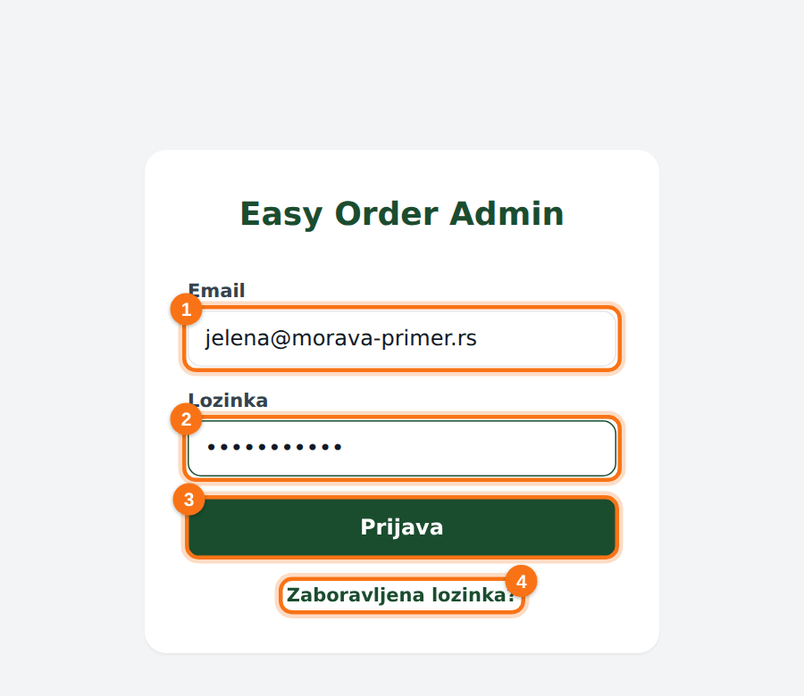

1. **Email** – email na koji ste dobili poruku.
2. **Lozinka** – privremena lozinka iz poruke.
3. **Prijava**.
4. **Zaboravljena lozinka?** – unesite email i stiže link za novu lozinku.

Pri prvoj prijavi traži se da privremenu lozinku zamenite svojom.

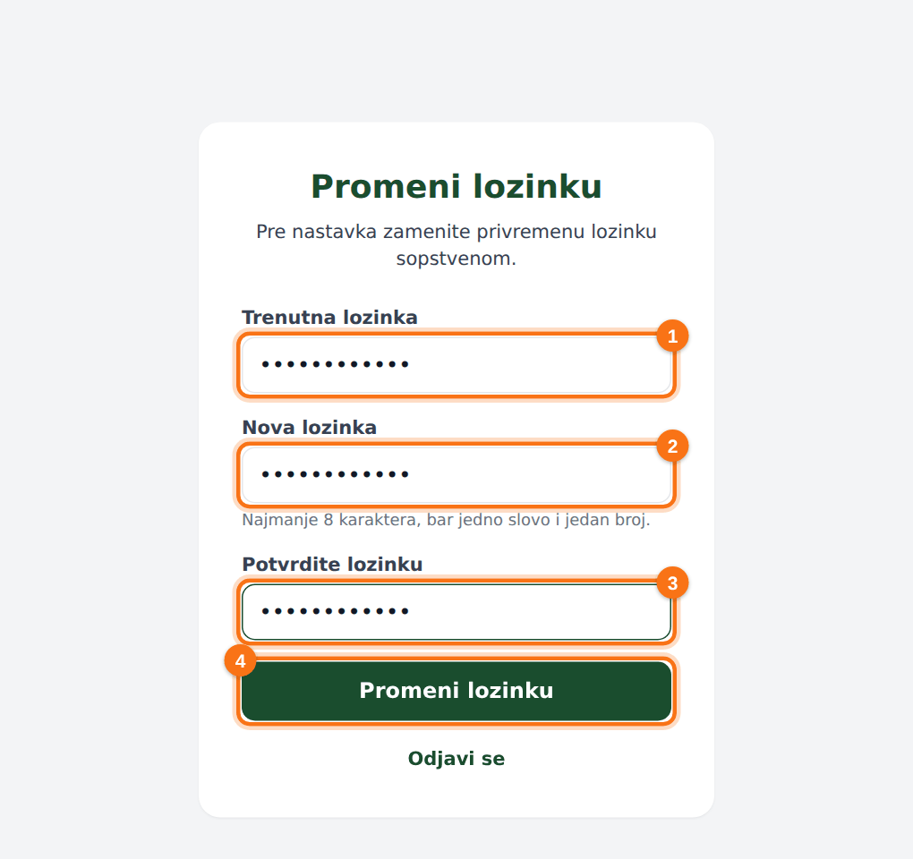

1. **Trenutna lozinka** – privremena iz emaila.
2. **Nova lozinka** – najmanje 8 znakova, bar jedno slovo i jedan broj.
3. **Potvrdite lozinku** – ista lozinka još jednom.
4. **Promeni lozinku**.

Kasnije lozinku menjate dugmetom **Promeni lozinku** u levom meniju. U istom meniju su izbor jezika (**SR / EN**) i **Odjavi se**.

> **Portal je za računar.** Na telefonu portal ne radi za vašu ulogu, za rad na telefonu koristite aplikaciju.

---

## 2. Kontrolna tabla

Posle prijave otvara se **Kontrolna tabla** sa pregledom prometa firme. Levo je meni sa svim stranicama.

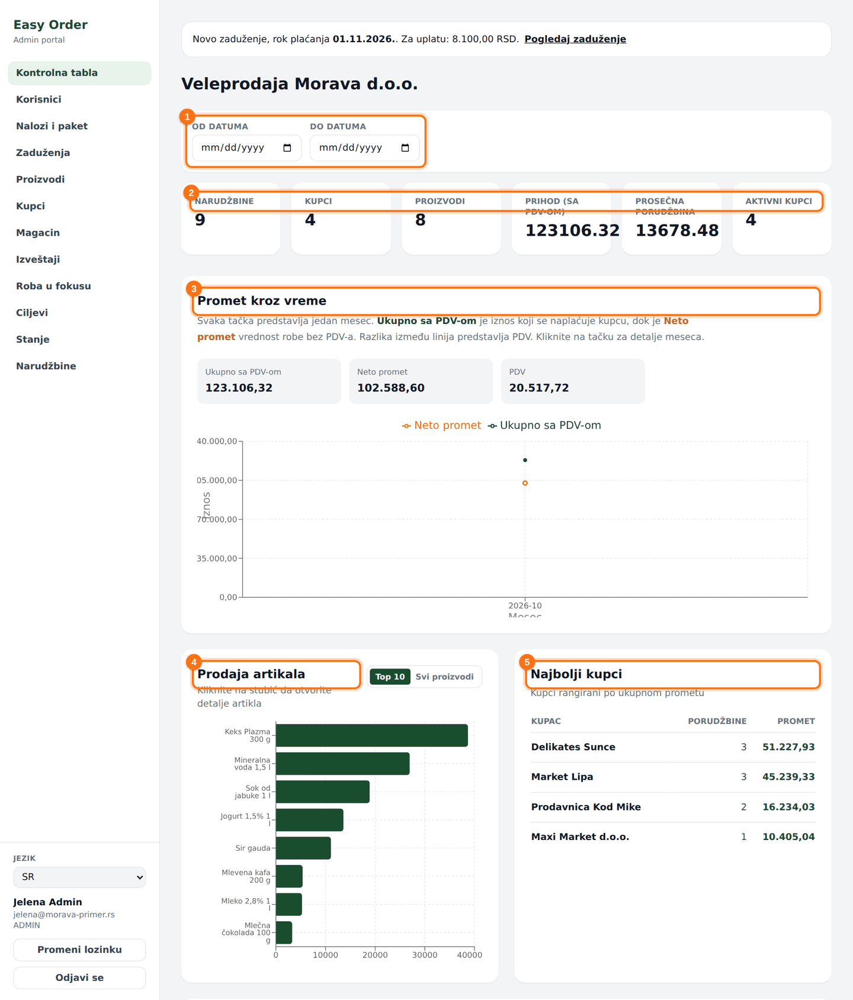

1. **Od datuma / Do datuma** – ograničite pregled na period. Prazno znači ceo period.
2. **Brojevi na vrhu** – narudžbine, kupci, proizvodi, prihod (sa PDV-om), prosečna porudžbina i aktivni kupci.
3. **Promet kroz vreme** – po mesecima, **neto** (bez PDV-a) i **ukupno sa PDV-om**. Dodir na tačku otvara detalje meseca.
4. **Prodaja artikala** – najprodavaniji artikli (**Top 10** ili **Svi proizvodi**). Dodir na stubić otvara detalje artikla.
5. **Najbolji kupci** – kupci po ukupnom prometu.
6. **Poslednje porudžbine**.

Na vrhu stranice se pojavljuje traka sa obaveštenjem, npr. o novom zaduženju (odeljak 12).

> U promet se ne računaju **otkazane i odbijene** porudžbine, a poslate se računaju po količini koju je magacin stvarno poslao.

---

## 3. Korisnici

Na stranici **Korisnici** otvarate naloge zaposlenima. Administrator firme može da napravi nalog za **komercijalistu** i **magacionera**.

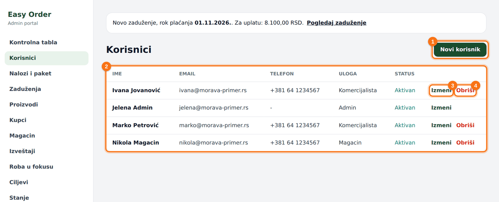

1. **Novi korisnik** – otvara formu za novi nalog.
2. **Spisak** – ime, email, telefon, uloga i status (**Aktivan** ili **Neaktivan**).
3. **Izmeni** – izmena podataka.
4. **Obriši** – brisanje naloga. Vaš nalog ne može da se obriše.

### Novi korisnik

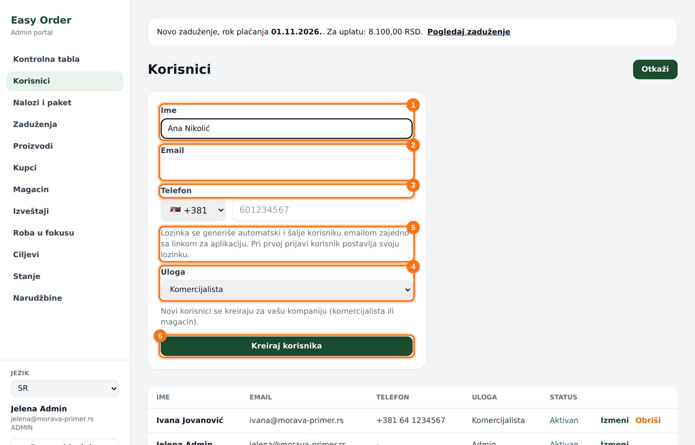

1. **Ime**.
2. **Email** – na njega stiže pozivnica i služi za prijavu.
3. **Telefon** – obavezan (izaberite pozivni broj i upišite broj).
4. **Uloga**: **Komercijalista** pravi porudžbine, **Magacin** ih obrađuje (ova uloga postoji ako firma ima modul magacin).
5. Lozinku ne upisujete. Sistem je pravi sam i šalje emailom zajedno sa linkom za aplikaciju. Korisnik pri prvoj prijavi postavlja svoju lozinku.
6. **Kreiraj korisnika**.

Posle kreiranja piše na koji je email poslata pozivnica. Ako slanje emaila ne uspe, na ekranu se prikaže privremena lozinka koju korisniku predate lično.

> **Ograničenje broja naloga.** Paket određuje koliko naloga svake uloge firma može da ima. Kad je ograničenje dostignuto, novi nalog se ne pravi, a poruka kaže da je dostignut limit. Pregled je u odeljku 4.

### Izmena korisnika

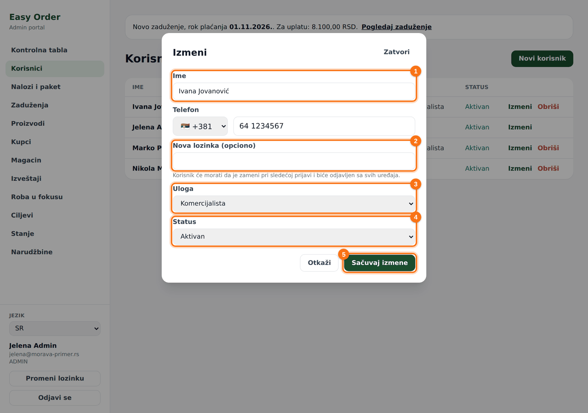

1. **Ime** i telefon.
2. **Nova lozinka (opciono)** – ako korisnik zaboravi lozinku, možete da mu postavite novu. On mora da je zameni pri sledećoj prijavi i odjavljuje se sa svih uređaja.
3. **Uloga** – komercijalista ili magacin. Promena odjavljuje korisnika sa svih uređaja.
4. **Status** – **Neaktivan** nalog ne može da se prijavi, a ostaje sačuvan sa istorijom porudžbina. Koristite ovo kad zaposleni ode.
5. **Sačuvaj izmene**.

> **Savet:** umesto brisanja, zaposlenom koji je otišao postavite status **Neaktivan**. Njegove porudžbine ostaju u istoriji i izveštajima.

---

## 4. Nalozi i paket

Stranica **Nalozi i paket** pokazuje koliko naloga imate u paketu i koliko je iskorišćeno.

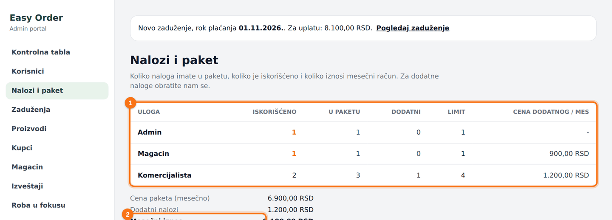

1. **Tabela po ulozi**: **Iskorišćeno** (koliko naloga već postoji), **U paketu**, **Dodatni** (ugovoreni dodatni nalozi), **Limit** (najviše naloga te uloge) i cena dodatnog naloga na mesec.
2. **Mesečni iznos** – cena paketa plus dodatni nalozi (uz popust ako je ugovoren). Toliko iznosi mesečno zaduženje.

Za dodatne naloge obratite se Easy Order podršci. Dodatni nalozi povećavaju limit odmah, a naplaćuju se sa sledećim zaduženjem.

---

## 5. Proizvodi

Na stranici **Proizvodi** vodite katalog koji komercijalisti vide u aplikaciji.

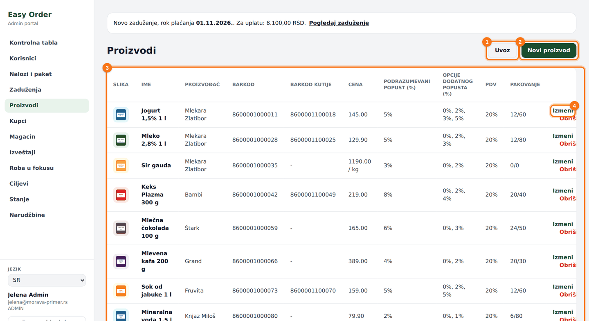

1. **Uvoz** – unos većeg broja proizvoda iz Excela.
2. **Novi proizvod** – dodavanje jednog proizvoda.
3. **Tabela** – slika, ime, proizvođač, barkod, cena, popusti, PDV i pakovanje. Tabela je široka, pa se pomera u stranu.
4. **Izmeni** i **Obriši** za svaki proizvod (na desnom kraju reda).

### Novi proizvod

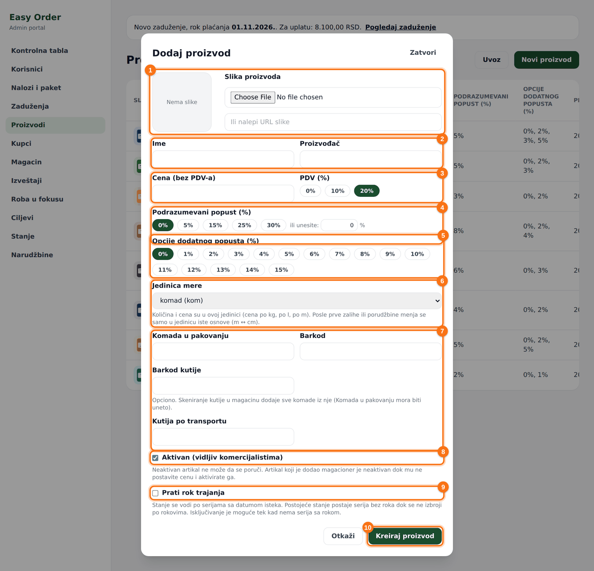

1. **Slika** – izaberite sliku sa računara (JPEG, PNG, WEBP ili HEIC do 4 MB) ili nalepite link. Slika se šalje tek kad pritisnete **Kreiraj proizvod**.
2. **Ime** (obavezno) i **Proizvođač**. Komercijalisti po proizvođaču filtriraju katalog.
3. **Cena (bez PDV-a)** (obavezna) i **PDV (%)**: 0, 10 ili 20.
4. **Podrazumevani popust (%)** – popust dobavljača koji se uvek primenjuje na artikal. Izaberite ponuđenu vrednost ili upišite svoju.
5. **Opcije dodatnog popusta (%)** – od 0 do 15%. Komercijalista bira jednu od izabranih vrednosti kad pravi porudžbinu. Ako izaberete samo 0%, dodatnog popusta nema.
6. **Jedinica mere** – komad, kilogram, litar, metar… Cena je po izabranoj jedinici (npr. 1190 din po kg), a količine u porudžbini se upisuju u njoj. Posle prve zalihe ili porudžbine jedinica može da se promeni samo u jedinicu iste vrste (npr. metar u centimetar).
7. **Komada u pakovanju**, **Barkod** (jednog komada), **Barkod kutije** i **Kutija po transportu**. Pakovanja i barkod kutije postoje samo za artikle koji se broje u komadima. Barkod kutije traži da je upisano **Komada u pakovanju**. Barkod mora da bude jedinstven u firmi (slova, cifre i crtica).
8. **Aktivan (vidljiv komercijalistima)** – neaktivan artikal komercijalisti ne vide i ne mogu da ga poruče.
9. **Prati rok trajanja** – stanje se vodi po serijama sa datumom isteka (vidi uputstvo za magacin). Polje postoji ako firma ima modul rokova.
10. **Kreiraj proizvod**.

> **Cene.** Promena cene ili popusta važi za nove porudžbine. Već poslate porudžbine ostaju sa cenom po kojoj su napravljene.

> **Artikal koji je dodao magacioner** ima cenu 0 i neaktivan je. Dopunite cenu i PDV i označite ga kao **Aktivan** da bi ga komercijalisti videli.

**Izmena** otvara istu formu sa popunjenim podacima (**Sačuvaj izmene**). **Obriši** briše proizvod iz kataloga, a poslate porudžbine zadržavaju njegove podatke.

### Uvoz iz Excela
Za veći broj artikala brže je da ih uvezete iz Excela.

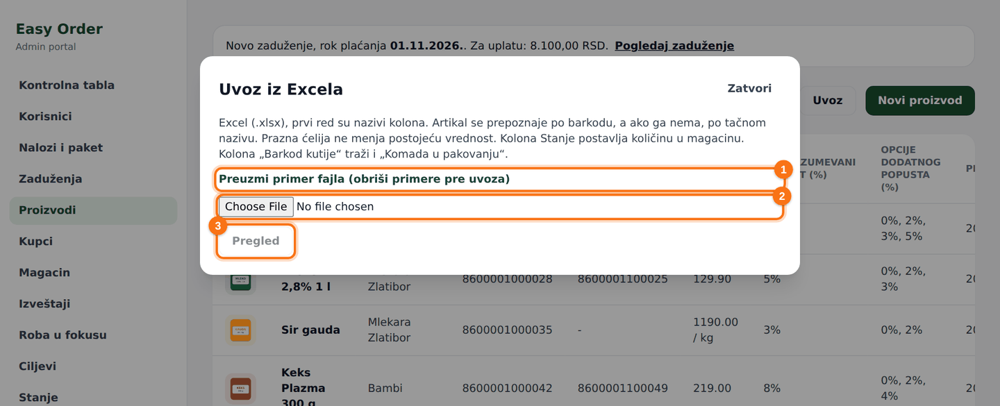

1. **Preuzmi primer fajla** – Excel sa pravim nazivima kolona i primerima. **Obrišite primere** pre uvoza, pa upišite svoje artikle.
2. **Izaberi fajl** – vaš .xlsx fajl (prvi red su nazivi kolona).
3. **Pregled** – prikazuje šta će se desiti, ništa se još ne upisuje.

Kolone su: **Naziv**, **Barkod**, **Proizvođač**, **Cena bez PDV**, **PDV %**, **Komada u pakovanju**, **Transportno pakovanje (komada)**, **Stanje (u jedinici mere)**, **Prati rok (da/ne)**, **Barkod kutije** i **Jedinica mere**. Samo **Naziv** je obavezan za novi artikal.

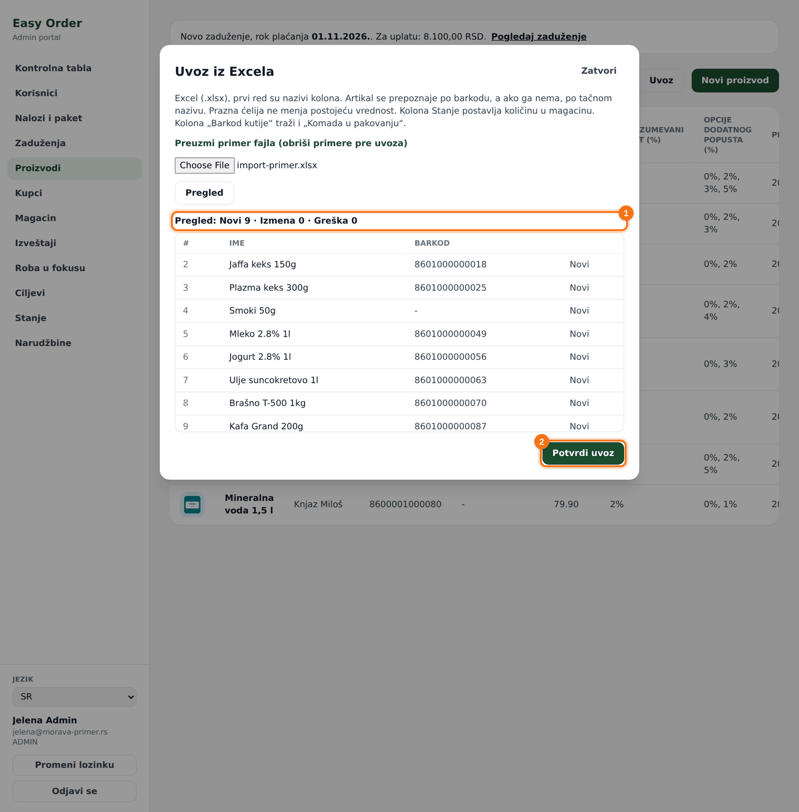

1. **Pregled: Novi 9 · Izmena 0 · Greška 0** – koliko artikala će biti dodato, izmenjeno i koliko redova ima grešku. Red sa greškom se ne uvozi, ostali ne zavise od njega.
2. **Potvrdi uvoz** – upisuje artikle.

Kako se artikal prepoznaje: prvo po **barkodu**, a ako ga nema, po **tačnom nazivu**. Postojeći artikal se izmeni, a novi se doda. **Prazna ćelija ne menja postojeću vrednost.** Kolona **Stanje** postavlja količinu u magacinu (u izabranoj jedinici mere), a kolona **Prati rok** uključuje ili isključuje praćenje roka.

---

## 6. Kupci

Na stranici **Kupci** vodite spisak kupaca koje komercijalisti biraju pri porudžbini.

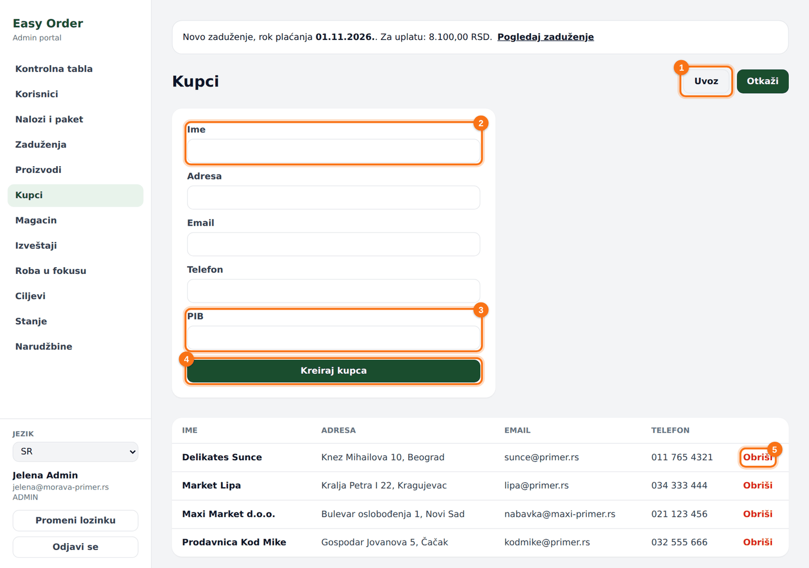

1. **Uvoz** – unos kupaca iz Excela, isto kao kod proizvoda. Kolone su **Naziv**, **Adresa**, **Email**, **Telefon** i **PIB**. Kupac se prepoznaje po PIB-u, a ako ga nema, po tačnom nazivu.
2. **Ime** (obavezno), **Adresa**, **Email** i **Telefon**.
3. **PIB** – navodi se na fakturi.
4. **Kreiraj kupca**.
5. **Obriši** – briše kupca (traži potvrdu). Poslate porudžbine ostaju sa podacima kupca.

Novi kupac se odmah pojavljuje komercijalistima.

> **Izmena podataka kupca** (adresa, telefon, email) radi se u aplikaciji: **Admin** → **Kupci** → ikonica olovke (odeljak 13).

---

## 7. Narudžbine

Stranica **Narudžbine** prikazuje sve porudžbine firme, najnovije prve.

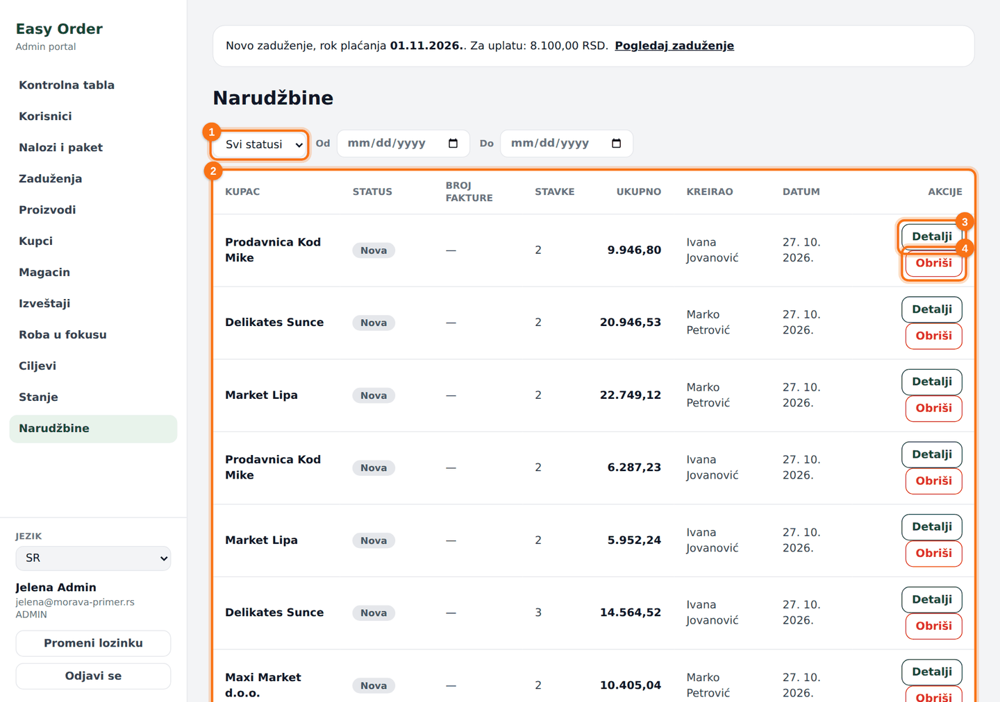

1. **Filteri**: status (Nova, U pripremi, Poslato, Odbijeno, Otkazano) i period (**Od** / **Do**).
2. **Tabela**: kupac, status, **Broj fakture** (dodeljuje se kad se porudžbina pošalje), broj stavki, ukupan iznos, ko je kreirao i datum.
3. **Detalji** – otvara fakturu i otpremnicu.
4. **Obriši** – brisanje porudžbine. Moguće je samo dok je porudžbina **Nova**.

### Faktura i otpremnica

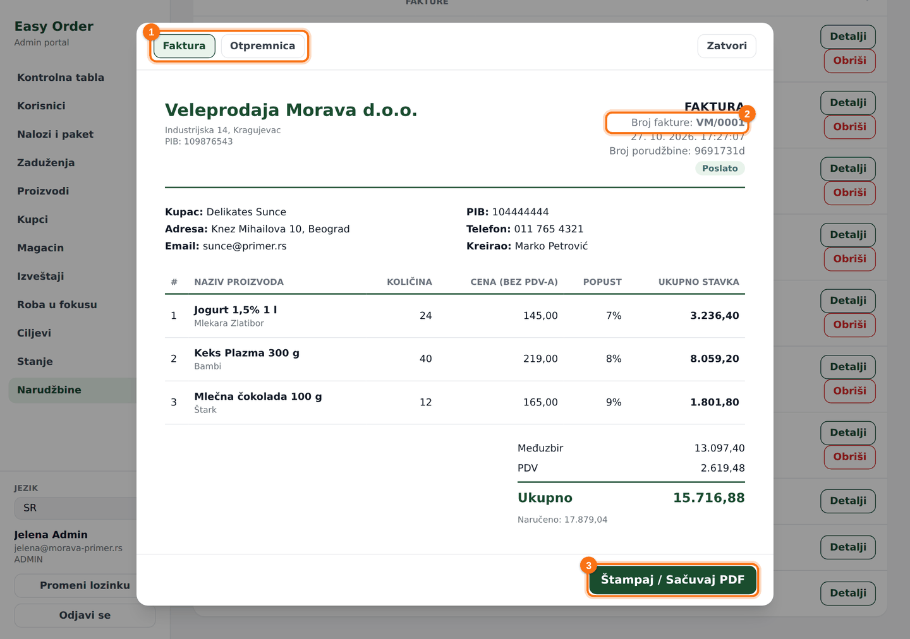

1. **Faktura / Otpremnica** – prebacivanje između dokumenata.
2. **Broj fakture** i podaci o kupcu, stavke sa količinom, cenom, popustom i ukupnim iznosom, pa osnovica, PDV i ukupno. Ako je poslato manje nego što je naručeno, ispod ukupnog iznosa piše **Naručeno** sa prvobitnim iznosom.
3. **Štampaj / Sačuvaj PDF** – štampa ili čuva dokument.

### Šta znače statusi
| Status | Značenje |
|---|---|
| **Nova** | Komercijalista je poslao porudžbinu, magacin je još nije preuzeo. |
| **U pripremi** | Magacin je preuzeo i pakuje. |
| **Poslato** | Magacin je poslao robu. Dodeljen je broj fakture. |
| **Odbijeno** | Magacin je odbio porudžbinu, razlog je upisan. |
| **Otkazano** | Komercijalista je otkazao (moguće dok je Nova). |

> Faktura se ne menja posle slanja. Broj fakture se dodeljuje samo jednom, prvim slanjem. Brojevi idu redom sa prefiksom koji je podešen za firmu (npr. VM/0001).

---

## 8. Magacin i Stanje

Ako firma ima ove module, u meniju su i **Magacin** i **Stanje**. Administrator ima ista prava kao magacioner: može da preuzme i pakuje porudžbine, da radi prijem robe, popis i otpis. Detalji sa slikama su u **uputstvu za magacin** (`magacin.md`), odeljci 4 do 9. U kratkim crtama:

- **Magacin** – spisak porudžbina za pakovanje (**Nova** i **U pripremi**), sa dugmićima **Preuzmi**, **Pošalji**, **Vrati u red**, **Odbij** i **Otpremnica**.
- **Stanje** – stanje svih artikala (**Na stanju**, **Rezervisano**, **Slobodno**, **Najraniji rok**), prijem, popis, istorija promena po artiklu i spisak artikala kojima ističe rok.

> Stanje se menja prijemom, popisom i slanjem porudžbina. Ako ne odgovara stvarnom, uradite **Popis**.

---

## 9. Izveštaji

**Izveštaji** pokazuju kako teče posao u izabranom periodu.

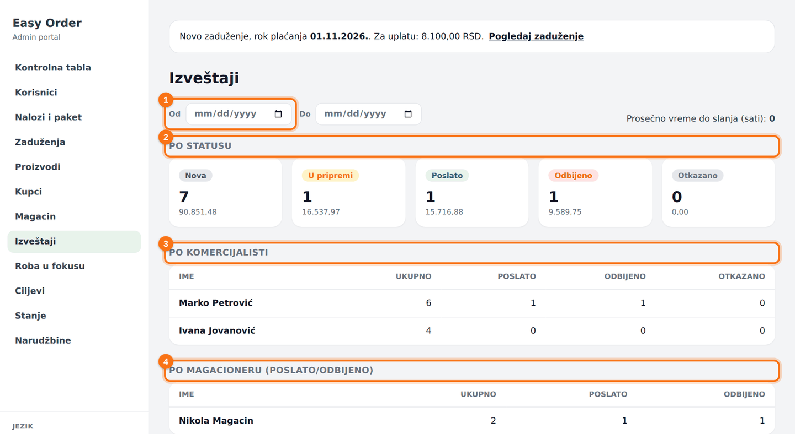

1. **Od / Do** – period (po datumu kreiranja porudžbine). Pored je prosečno vreme od porudžbine do slanja u satima.
2. **Po statusu** – koliko porudžbina je u svakom statusu i njihov ukupan iznos.
3. **Po komercijalisti** – koliko je ko napravio porudžbina, koliko je poslato, odbijeno i otkazano.
4. **Po magacioneru** – koliko je ko poslao i odbio porudžbina.

---

## 10. Roba u fokusu

Ovde birate artikle na koje komercijalisti treba da obrate posebnu pažnju: nešto ima previše na lageru, nekom artiklu ističe rok ili je u akciji. Komercijalisti ih u aplikaciji vide naglašene, uz vašu napomenu.

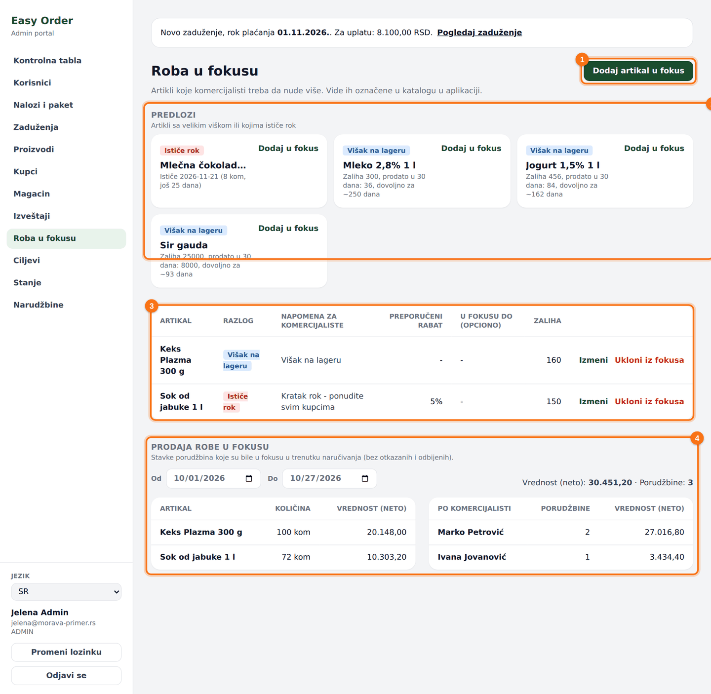

1. **Dodaj artikal u fokus**.
2. **Predlozi** – sistem sam predlaže artikle sa velikim viškom (zalihe za 90 dana i više, ili bez prodaje u poslednjih 30 dana) i artikle kojima ističe rok. Dodir na **Dodaj u fokus** otvara formu sa već izabranim razlogom.
3. **Spisak artikala u fokusu** – razlog, napomena, preporučeni rabat, do kad je u fokusu i zaliha. **Izmeni** menja podatke, a **Ukloni iz fokusa** skida artikal sa liste.
4. **Prodaja robe u fokusu** – izveštaj o prodaji ovih artikala (vidi niže).

### Dodavanje artikla u fokus

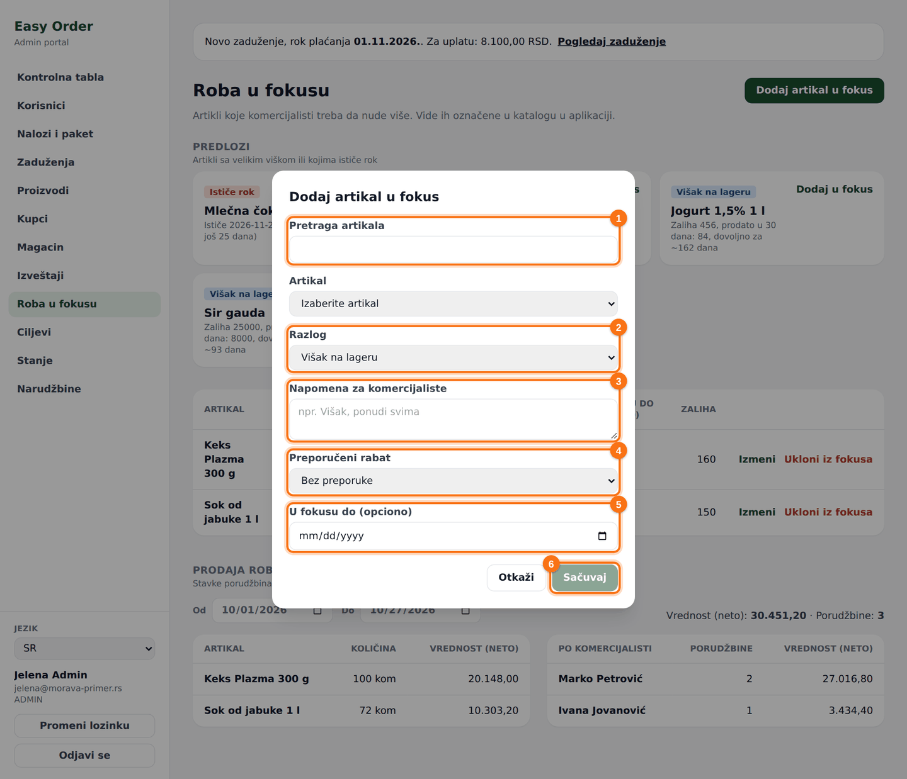

1. **Artikal** – potražite ga (polje **Pretraga artikala**) pa izaberite. Moguće su samo aktivni artikli koji još nisu u fokusu.
2. **Razlog**: **Višak na lageru**, **Ističe rok**, **Akcija** ili **Ostalo**.
3. **Napomena za komercijaliste** – kratka poruka (do 300 znakova), npr. „Višak, ponudi svima“.
4. **Preporučeni rabat** – opciono. Biraju se samo vrednosti koje ste artiklu dozvolili kao **dodatni popust** (odeljak 5). Komercijalista jednim dodirom primenjuje preporuku ili izabere drugu vrednost.
5. **U fokusu do** – opciono. Posle tog datuma artikal sam izlazi iz fokusa.
6. **Sačuvaj**.

Šta vide komercijalisti: narandžastu oznaku sa razlogom i napomenom, preporučeni popust sa dugmetom **Primeni**, a artikli u fokusu su na vrhu kataloga. Kod razloga **Ističe rok** vide **datum isteka i količinu** koja ističe (to je jedino mesto gde komercijalisti vide rok) i dužni su da kupca upozore.

> Neaktivan artikal se ne prikazuje komercijalistima ni kad je u fokusu.

### Prodaja robe u fokusu
Ispod liste je izveštaj: izaberite period (**Od / Do**, podrazumevano tekući mesec) i vidite ukupnu vrednost i broj porudžbina sa artiklima iz fokusa, prodaju po artiklu i po komercijalisti. Računaju se stavke koje su **bile u fokusu u trenutku naručivanja**, bez otkazanih i odbijenih porudžbina.

---

## 11. Ciljevi

Na stranici **Ciljevi** postavljate ciljeve prodaje komercijalistima i pratite koliko su ostvarili.

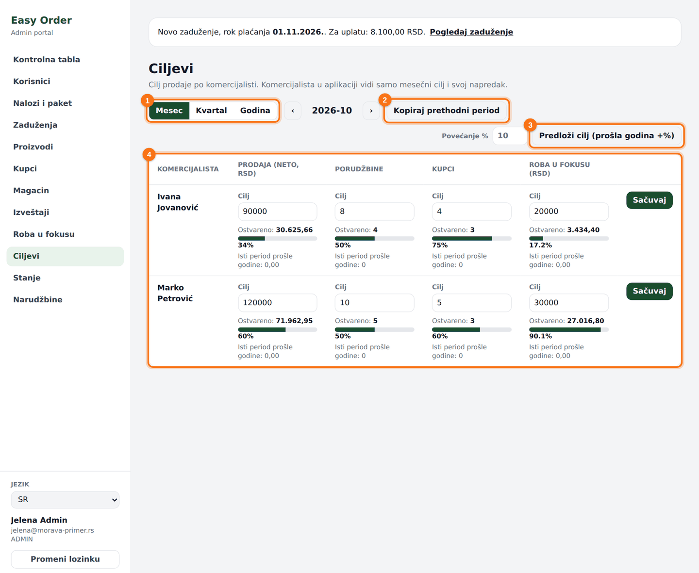

1. **Mesec / Kvartal / Godina** i strelice za pomeranje perioda. Komercijalista u aplikaciji vidi samo **mesečni** cilj, a kvartalne i godišnje vidite samo vi.
2. **Kopiraj prethodni period** – prepisuje ciljeve iz prethodnog perioda tamo gde još nisu postavljeni.
3. **Predloži cilj (prošla godina +%)** – popunjava prazna polja ostvarenjem iz istog perioda prošle godine uvećanim za procenat iz polja **Povećanje %**. Predlog se ne čuva dok ne pritisnete **Sačuvaj**.
4. **Tabela** – za svakog komercijalistu četiri cilja: **Prodaja (neto, RSD)**, **Porudžbine**, **Kupci** (broj različitih kupaca) i **Roba u fokusu (RSD)**. Ispod svakog polja su **Ostvareno**, traka sa procentom i **Isti period prošle godine** (uz razliku u procentima). Prazno polje znači da cilj nije postavljen, a **Sačuvaj** čuva red.

Kako se računa ostvarenje: porudžbine komercijaliste u izabranom periodu, čim su potvrđene, bez otkazanih i odbijenih. Poslate se računaju po stvarno poslatoj količini. Iznosi su bez PDV-a. Komercijalista ne vidi poredak kolega, samo svoj napredak.

---

## 12. Zaduženja

Stranica **Zaduženja** pokazuje račun za korišćenje Easy Order i kako da ga platite.

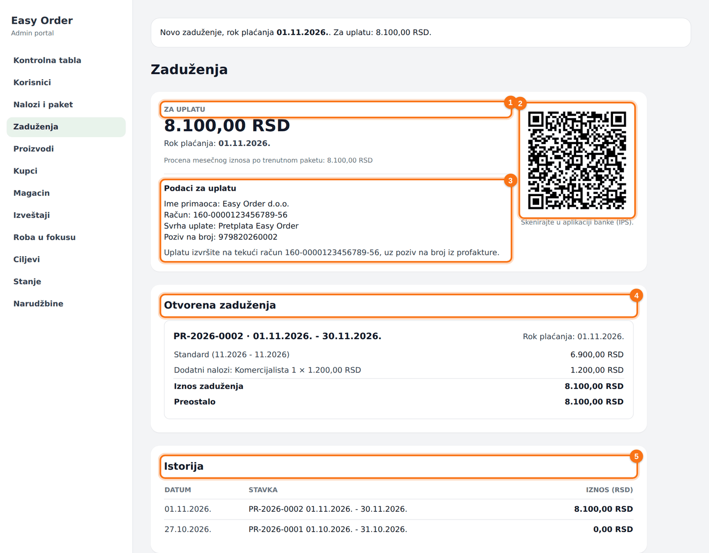

1. **Za uplatu** – ukupan iznos otvorenih zaduženja i **rok plaćanja**. Na vrhu portala (i u aplikaciji pri prijavi) stoji obaveštenje kad se pojavi novo zaduženje.
2. **IPS QR kod** – skenirajte ga u aplikaciji vaše banke i uplata se popuni sama (iznos, račun, poziv na broj).
3. **Podaci za uplatu** – primalac, račun, svrha i **poziv na broj** za ručnu uplatu.
4. **Otvorena zaduženja** – svaka profaktura (npr. PR-2026-0002) sa razlogom: cena paketa i dodatni nalozi.
5. **Istorija** – sve izdate profakture.

Zaduženje se izdaje za naredni mesec i obično dospeva prvog u mesecu. Obaveštenje o novom zaduženju, podsetnik posle roka i upozorenje pre blokade stižu emailom administratorima (i na email računovodstva ako je upisan). Kad uplata stigne, Easy Order je evidentira i zaduženje nestaje sa liste otvorenih.

> **Ne kasnite sa uplatom.** Ako zaduženje ostane neplaćeno nekoliko dana posle roka, korišćenje sistema se **blokira**: komercijalisti i magacioneri se ne mogu prijaviti, a vi možete da se prijavite samo da vidite stranicu **Zaduženja**. Posle evidentirane uplate pristup se vraća. Ako ste platili, a nalog je blokiran, javite se Easy Order podršci.

---

## 13. Aplikacija na telefonu

Administrator se u Android aplikaciju prijavljuje istim emailom i lozinkom. Dole su kartice **Porudžbina**, **Magacin**, **Istorija** i **Admin**.

- **Porudžbina** i **Istorija** rade kao kod komercijaliste (vidi uputstvo za komercijalistu, `komercijalista.md`). Administrator vidi istoriju svih porudžbina firme.
- **Magacin** – pakovanje, prijem, popis i rokovi, kao u uputstvu za magacin.
- **Admin** – proizvodi i kupci, opisano niže.

### Admin – proizvodi i kupci

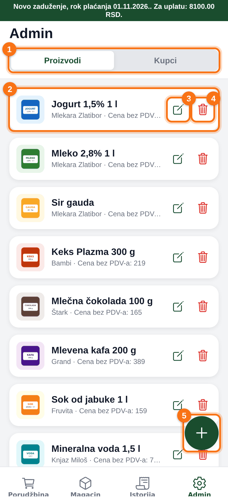

1. **Proizvodi / Kupci** – prekidač između dva spiska.
2. **Stavka** – slika, ime, proizvođač i cena.
3. **Izmena** (olovka).
4. **Brisanje** (kanta, traži potvrdu).
5. **+** – dodavanje novog proizvoda ili kupca.

### Forma za proizvod
Ista polja kao u portalu (odeljak 5), na kliznom panelu.

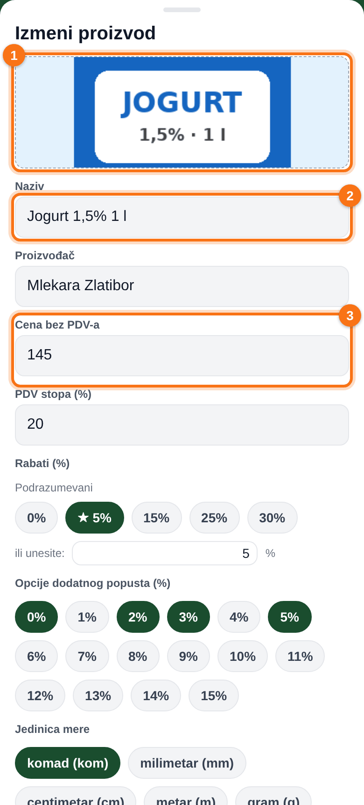

1. **Slika** – dodirnite da izaberete sliku sa telefona (aplikacija traži dozvolu za galeriju).
2. **Naziv**.
3. **Cena bez PDV-a** i **PDV stopa**.

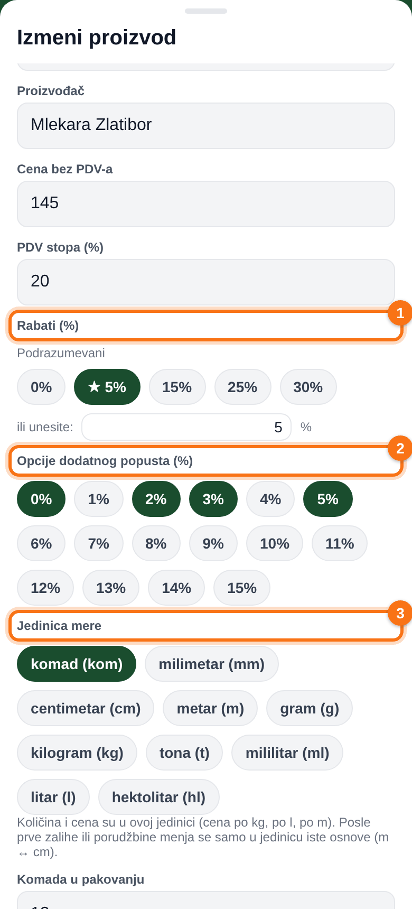

1. **Rabati (%)** – **Podrazumevani** popust (zvezdica označava izabrani) i polje **ili unesite**.
2. **Opcije dodatnog popusta (%)** – dodirom birate koje vrednosti komercijalista sme da koristi (izabrane su zelene).
3. **Jedinica mere** – komad, kg, litar…

Klizanjem naniže su još **Komada u pakovanju**, **Barkod** i **Barkod kutije** (uz ikonicu kamere da ih skenirate), **Transportno pakovanje**, prekidač **Aktivan (vidljiv komercijalistima)** i **Prati rok trajanja**, pa **Sačuvaj**.

### Forma za kupca

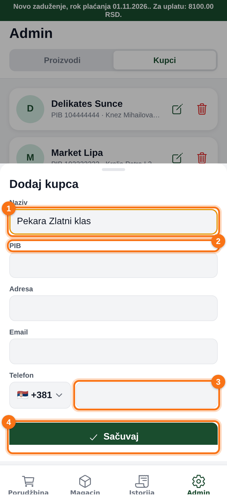

1. **Naziv** (obavezno).
2. **PIB**, a pod njim **Adresa** i **Email**.
3. **Telefon** – pozivni broj i broj.
4. **Sačuvaj**.

Isti obrazac služi i za izmenu postojećeg kupca (olovka na spisku).

---

## 14. Šta administrator firme ne menja

Neka podešavanja firme menja samo Easy Order tim:

- naziv, adresa, PIB, matični broj, račun i **logo** koji se štampaju na fakturi,
- **prefiks i način numeracije faktura** (automatska ili ručna),
- **paket i moduli** firme (šta je uključeno u meniju) i broj naloga,
- pragovi upozorenja o **roku trajanja** (podrazumevano 30, 15 i 5 dana),
- izdavanje i evidentiranje uplata.

Za izmenu bilo čega od ovoga obratite se Easy Order podršci.

---

## 15. Česta pitanja i problemi

**Zaposleni ne dobija email sa pozivnicom.**
Proverite da li je email ispravno upisan i da li je u spamu. Ako slanje nije uspelo, portal prikaže privremenu lozinku koju mu predajete lično. Možete mu u **Izmeni** postaviti i novu lozinku.

**Zaposleni je zaboravio lozinku.**
Može da pritisne **Zaboravljena lozinka?** na ekranu za prijavu, ili mu vi u **Izmeni** postavite novu.

**„Dostignut je broj naloga za ovu ulogu.“**
Paket nema više naloga te uloge. Pogledajte **Nalozi i paket** i obratite se Easy Order podršci za dodatni nalog, ili deaktivirajte nalog koji vam ne treba.

**Komercijalista ne vidi neki artikal.**
Artikal je **neaktivan** ili ne postoji. Proverite u **Proizvodi** da li je označen kao **Aktivan** i da li ima cenu.

**Komercijalista ne vidi karticu „Moj učinak“ ili oznaku fokusa.**
Firma nema modul **Ciljevi** odnosno **Roba u fokusu**. Obratite se Easy Order podršci.

**Artikal se ne uvozi iz Excela.**
Pogledajte pregled pre potvrde: red sa greškom piše razlog (npr. barkod već postoji kod drugog artikla, ili je naveden barkod kutije bez „Komada u pakovanju“).

**Ne mogu da obrišem porudžbinu.**
Brisanje je moguće samo dok je porudžbina **Nova**. Posle preuzimanja u magacin porudžbina se ne briše.

**Portal pita za lozinku iako sam se prijavio.**
Sesija je istekla, prijavite se ponovo.

**Nalog je blokiran / „Pretplata je istekla“.**
Proverite stranicu **Zaduženja**. Ako je zaduženje plaćeno, javite se Easy Order podršci.
