# Uputstvo za komercijalistu

Easy Order je aplikacija u kojoj kod kupca primate porudžbinu: izaberete kupca, unesete količine i popuste, potvrdite i dobijete narudžbenicu koju možete da pošaljete kupcu. Porudžbina odmah stiže u magacin, a u aplikaciji pratite da li je pripremljena i poslata.

> **Ukratko – jedna porudžbina u 5 koraka**
>
> 1. **Izaberi kupca** (zeleno polje na vrhu).
> 2. **Nađi artikal** – pretraga po nazivu, proizvođaču ili barkodu.
> 3. **Upiši količinu** i po potrebi izaberi **dodatni popust**.
> 4. Dole pritisni **Potvrdi**, proveri spisak i ponovo **Potvrdi**.
> 5. Na ekranu **Faktura** pošalji narudžbenicu kupcu (email, PDF ili kopiraj).
>
> Pazite na artikle označene kao **U fokusu** – to su artikli koje vaša firma želi da se više nude (odeljak 5). Napredak prema vašem cilju pratite na kartici **Moj učinak** (odeljak 9).

Na slikama su važni delovi uokvireni narandžastim okvirom, a broj u krugu odgovara broju u tekstu ispod slike.

---

## 1. Prva prijava

### Gde dobijam aplikaciju i lozinku?
Kada vam administrator otvori nalog, na email stiže poruka sa:

- linkom za preuzimanje Android aplikacije (APK),
- vašim emailom za prijavu i **privremenom lozinkom**.

Preuzmite aplikaciju sa linka i instalirajte je. Ako telefon pita da li dozvoljavate instalaciju iz ovog izvora, potvrdite.

### Prijava

1. **Email** – email na koji ste dobili poruku.
2. **Lozinka** – privremena lozinka iz emaila (ikonica oka prikazuje šta ste ukucali).
3. **Prijava**.
4. **Zaboravljena lozinka?** – ako ne znate lozinku: unesite email i stići će vam link za novu lozinku.

### Postavite svoju lozinku
Pri prvoj prijavi aplikacija traži da privremenu lozinku zamenite svojom.

1. **Trenutna lozinka** – privremena lozinka iz emaila.
2. **Nova lozinka** – najmanje 8 znakova, bar jedno slovo i jedan broj.
3. **Potvrdi lozinku** – ista nova lozinka još jednom.

Pritisnite **Promena lozinke** i aplikacija se otvara. Sledeći put se prijavljujete novom lozinkom.

> **Savet:** aplikacija pamti prijavu. Ne morate da se prijavljujete svaki put, samo posle odjave ili promene lozinke.

---

## 2. Glavni ekran – Porudžbina

Posle prijave otvara se ekran **Porudžbina**. Na dnu ekrana su kartice: **Porudžbina** (unos), **Moj učinak** (vaš cilj i napredak, vidi se samo ako ga vaša firma koristi) i **Istorija** (vaše porudžbine).

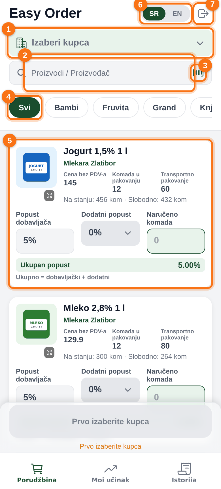

1. **Izaberi kupca** – za koga pravite porudžbinu. Dok kupac nije izabran, porudžbina ne može da se potvrdi.
2. **Pretraga** – kucajte deo naziva artikla ili proizvođača.
3. **Barkod** – otvara kameru: skenirate barkod sa artikla i aplikacija odmah prikaže taj artikal.
4. **Proizvođači** – brzi filter: dodirnite proizvođača da vidite samo njegove artikle, **Svi** vraća ceo katalog. Ako vaša firma ističe robu u fokusu, ispred proizvođača stoji i narandžasti čip **Fokus** (odeljak 5).
5. **Kartica artikla** – ovde unosite količinu i popust (objašnjeno u odeljku 4).
6. **SR / EN** – jezik aplikacije.
7. **Odjava**.

---

## 3. Izbor kupca

Dodirnite **Izaberi kupca**. Otvara se spisak kupaca.

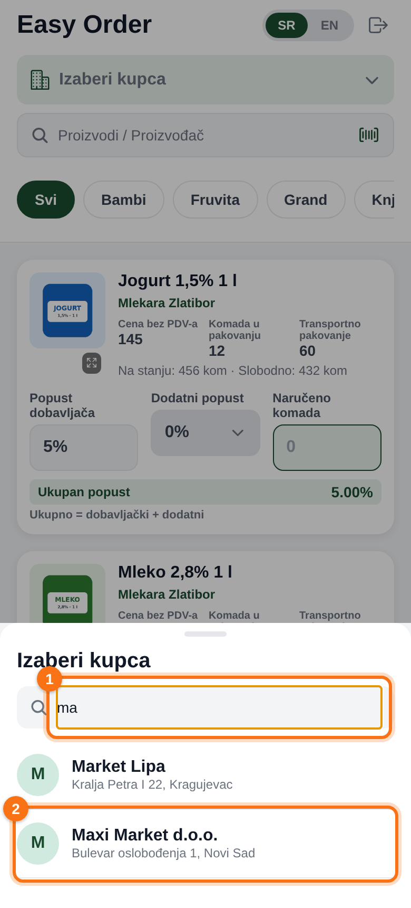

1. **Pretraga** – ukucajte deo naziva (npr. „ma“ za Maxi Market i Market Lipa).
2. Dodirnite kupca. Spisak se zatvara, a ime kupca se vidi u zelenom polju na vrhu.

Kupca možete da promenite bilo kada pre potvrde, uneti artikli ostaju.

> Kupca ne vidite na spisku? Kupce dodaje administrator. Javite mu naziv, PIB i adresu kupca.

---

## 4. Kartica artikla – šta znači koje polje

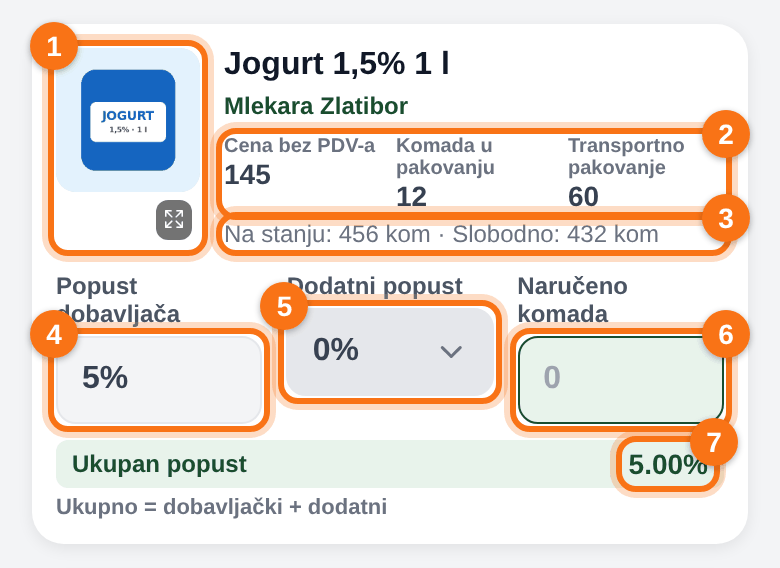

1. **Slika** – dodirnite je da je vidite preko celog ekrana.
2. **Cena bez PDV-a**, **komada u pakovanju** i **transportno pakovanje** (koliko pakovanja ide na paletu / u transport).
3. **Na stanju** i **Slobodno** – koliko ima u magacinu i koliko od toga nije već rezervisano drugim porudžbinama. Važno je **Slobodno**.
4. **Popust dobavljača** – osnovni popust za artikal. Ne menja se.
5. **Dodatni popust** – popust koji vi birate (samo iz ponuđenih vrednosti).
6. **Naručeno komada** – ovde upisujete količinu.
7. **Ukupan popust** – zbir popusta dobavljača i dodatnog popusta, sa njim se računa cena.

---

## 5. Roba u fokusu

Administrator može da označi artikle na koje želi da obratite posebnu pažnju: nešto ima previše na lageru, nekom artiklu se bliži rok trajanja ili je u akciji. Takvi artikli su u katalogu naglašeni, pa ih lako primetite i ponudite kupcu. Ova funkcija se vidi samo ako je vaša firma koristi.

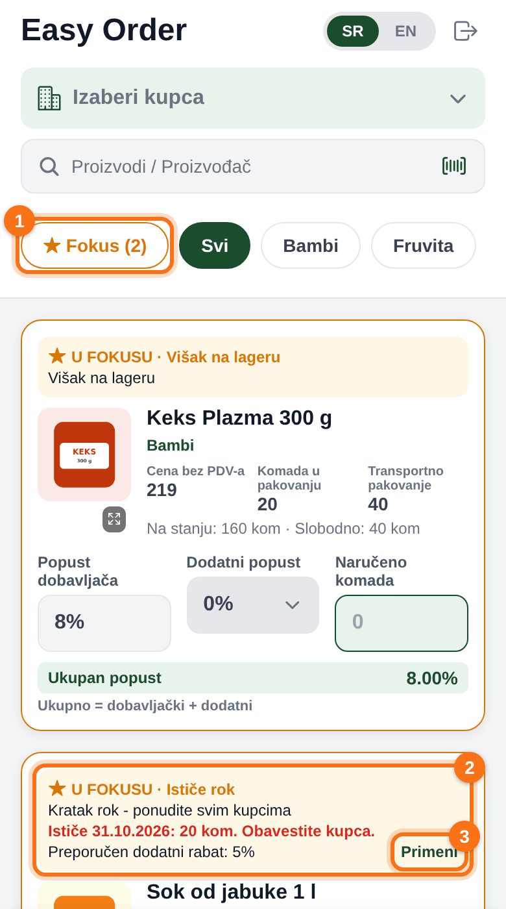

1. **Fokus (2)** – čip sa brojem artikala u fokusu. Dodir prikazuje samo te artikle, drugi dodir vraća ceo katalog. Artikli u fokusu su u katalogu uvek na vrhu liste.
2. **Narandžasta traka na kartici** – kaže zašto je artikal u fokusu i šta administrator poručuje (napomena). Cela kartica ima narandžasti okvir.
3. **Primeni** – preporučeni dodatni popust (objašnjeno niže).

### Zašto je artikal u fokusu

| Oznaka | Značenje |
|---|---|
| **Višak na lageru** | Firma ima više robe nego što se prodaje. Ponudite je kupcima. |
| **Ističe rok** | Roku trajanja se bliži kraj. Vidite datum i količinu koja ističe. |
| **Akcija** | Artikal je u akciji. |
| **Preporuka** | Administrator preporučuje artikal, a razlog je u napomeni. |

> **Rok trajanja – obavestite kupca.** Kod artikala sa oznakom **Ističe rok** crvenom bojom piše datum i količina (npr. „Ističe 31.10.2026: 20 kom“). Ako je rok blizu, dužni ste da kupca upozorite pre nego što on poruči. Za artikle koji nisu u fokusu rok se ne prikazuje.

### Preporučeni dodatni popust
Administrator može da preporuči dodatni popust za artikal (npr. kad robi ističe rok). Dodirnite **Primeni** i polje **Dodatni popust** se postavlja na preporučenu vrednost. Posle toga piše **Primenjeno**.

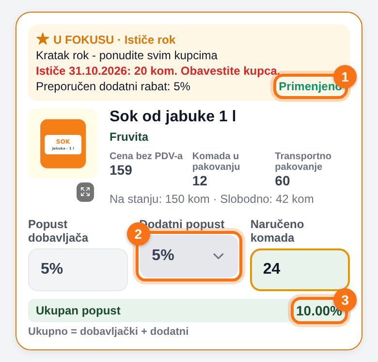

1. **Primenjeno** – preporučeni popust je postavljen.
2. **Dodatni popust** je sada **5%**. Možete da ga promenite na drugu ponuđenu vrednost, preporuka nije obaveza.
3. **Ukupan popust** je zbir popusta dobavljača i dodatnog popusta (kao i inače).

### Podsetnik pri potvrdi
Ako u porudžbini nema nijednog artikla iz fokusa, pri potvrdi se pojavi narandžasta napomena. Ne sprečava vas da pošaljete porudžbinu, samo vas podseća da proverite da li ste kupcu ponudili robu iz fokusa.

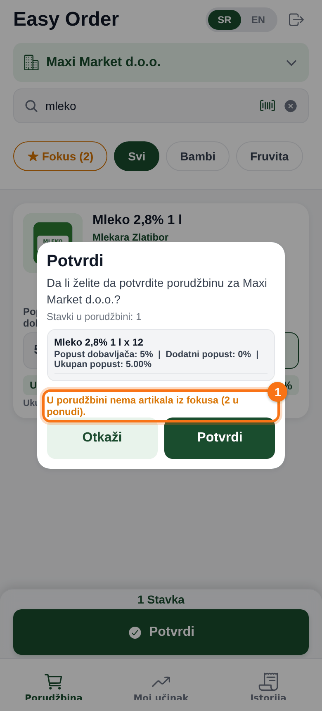

1. **U porudžbini nema artikala iz fokusa (2 u ponudi)** – broj u zagradi je koliko artikala je trenutno u fokusu.

---

## 6. Primer: porudžbina za Maxi Market

Kupac Maxi Market d.o.o. naručuje:

- **24 jogurta** sa dodatnim popustom **3%**,
- **36 mleka** bez dodatnog popusta,
- **2,5 kg sira gaude**.

### Korak 1 – izaberite kupca
Kao u odeljku 3: **Izaberi kupca** → „ma“ → **Maxi Market d.o.o.**

### Korak 2 – jogurt: dodatni popust i količina
Na kartici jogurta dodirnite polje **Dodatni popust**. Otvara se spisak dozvoljenih popusta za taj artikal.

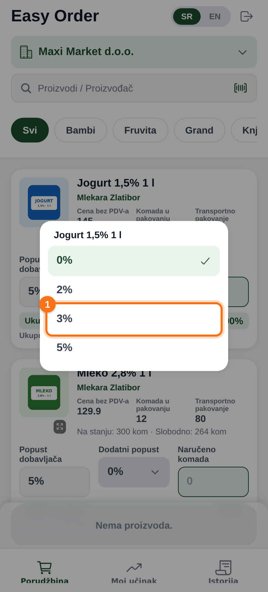

1. Izaberite **3%**.

Zatim u **Naručeno komada** upišite **24**.

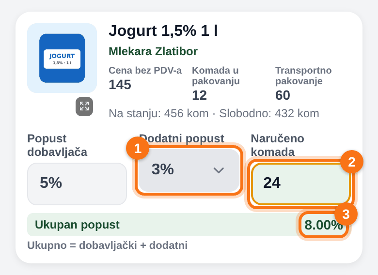

1. Dodatni popust je sada **3%**.
2. Količina **24**.
3. **Ukupan popust** je **8%** (5% dobavljača + 3% dodatni).

> **Pažnja:** ako artikal nema ponuđene dodatne popuste, u spisku je samo 0%. Popuste za artikle određuje administrator.

### Korak 3 – mleko: filter po proizvođaču
Da ne biste listali ceo katalog, dodirnite proizvođača **Mlekara Zlatibor** u redu sa proizvođačima. Vide se samo njegovi artikli. Kod mleka upišite **36**.

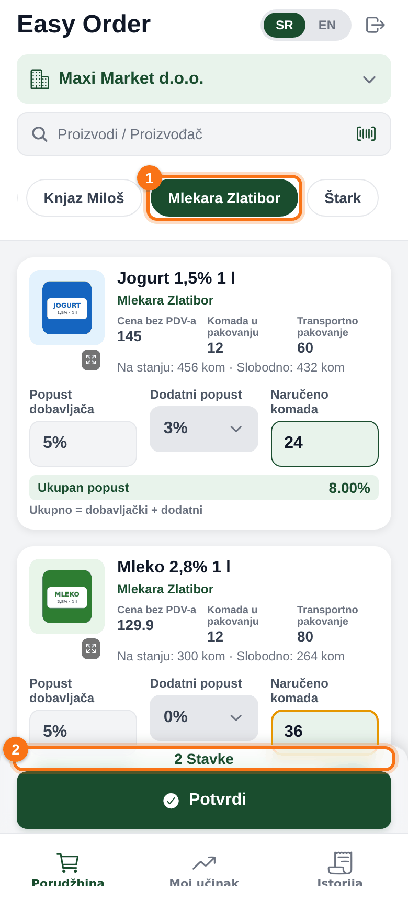

1. Izabran proizvođač (zeleno). **Svi** vraća sve artikle.
2. Brojač na dnu pokazuje koliko različitih artikala je u porudžbini (**2 stavke**).

### Korak 4 – sir: pretraga i artikal na kilogram
U pretragu ukucajte **gauda**. Kod artikala koji se prodaju na kilogram (litar, metar) polje se zove **Količina (kg)**, cena je po kilogramu, a količina može da ima decimale. Upišite **2,5**.

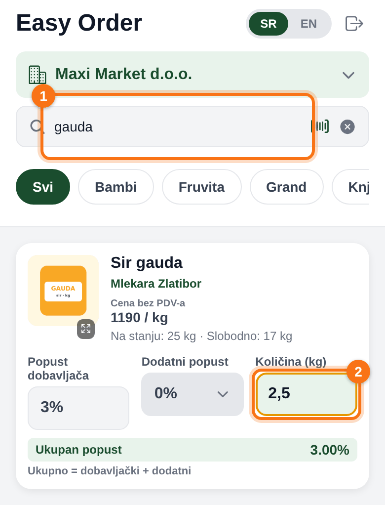

1. Pretraga po nazivu (krstić desno briše pretragu).
2. **Količina (kg)**: 2,5 znači 2,5 kg.

### Ako naručite više nego što je slobodno
Aplikacija vas upozori, ali vas ne sprečava da pošaljete porudžbinu. Magacin će poslati koliko ima, a na porudžbini ćete videti stvarno poslatu količinu (odeljak 8).

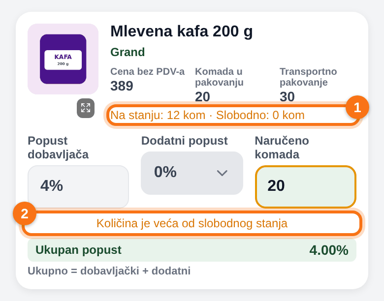

1. **Slobodno: 0 kom** – sve što je na stanju već je rezervisano.
2. Narandžasto upozorenje **Količina je veća od slobodnog stanja**.

> **Savet:** pre nego što kupcu obećate količinu, pogledajte **Slobodno**, ne **Na stanju**.

### Korak 5 – potvrda porudžbine
Dole pritisnite **Potvrdi**.

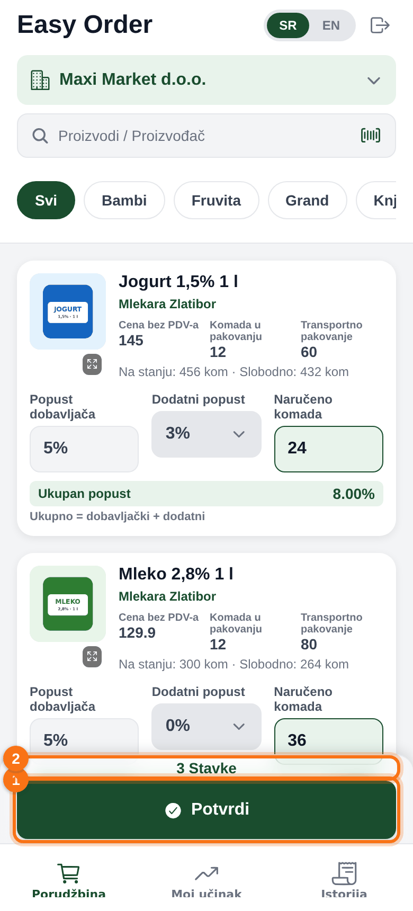

1. **Potvrdi** – postaje aktivno kada su izabrani kupac i bar jedan artikal.
2. Broj stavki u porudžbini.

Otvara se spisak za proveru: svaki artikal sa količinom i popustima.

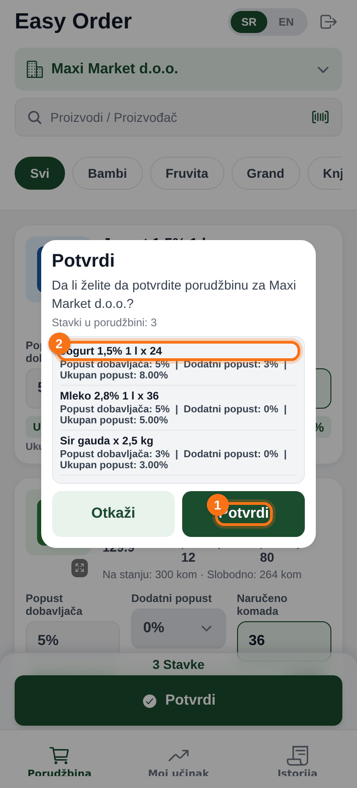

1. **Potvrdi** šalje porudžbinu. **Otkaži** vraća na unos bez gubljenja unetog.
2. Proverite artikle, količine i popuste.

> Cene i popusti se uzimaju iz kataloga u trenutku slanja. Ako administrator kasnije promeni cenu, poslata porudžbina se ne menja.

---

## 7. Faktura (narudžbenica) – slanje kupcu

Posle potvrde otvara se ekran **Faktura** sa svim podacima kupca, stavkama i ukupnim iznosom.

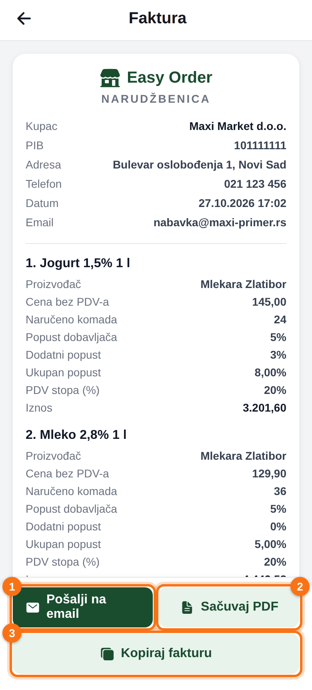

1. **Pošalji na email** – otvara email sa narudžbenicom u PDF-u. Ako kupac ima email u sistemu, već je upisan kao primalac.
2. **Sačuvaj PDF** – pravi PDF koji možete da podelite (Viber, WhatsApp, Drive…).
3. **Kopiraj fakturu** – kopira narudžbenicu kao tekst, pa je nalepite u poruku.

Na dnu su zbirovi:

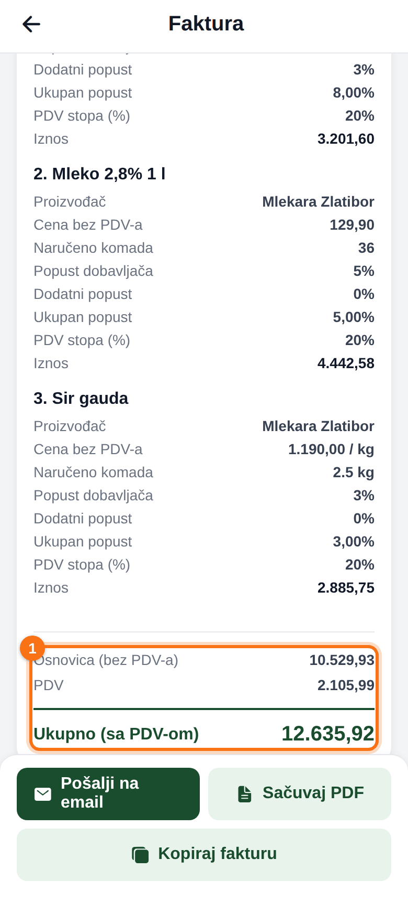

1. **Osnovica (bez PDV-a)**, **PDV** i **Ukupno (sa PDV-om)**.

Strelica gore levo vraća vas nazad. Istu fakturu kasnije otvarate iz **Istorije**.

---

## 8. Istorija – praćenje porudžbina

Kartica **Istorija** (dole desno) prikazuje sve vaše porudžbine, najnovije na vrhu. Dodirom na porudžbinu otvarate njenu fakturu.

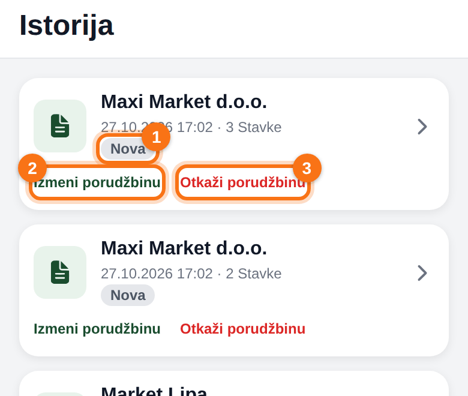

1. **Status** porudžbine.
2. **Izmeni porudžbinu** – samo dok je status **Nova**.
3. **Otkaži porudžbinu** – samo dok je status **Nova** (aplikacija traži potvrdu).

### Šta znače statusi

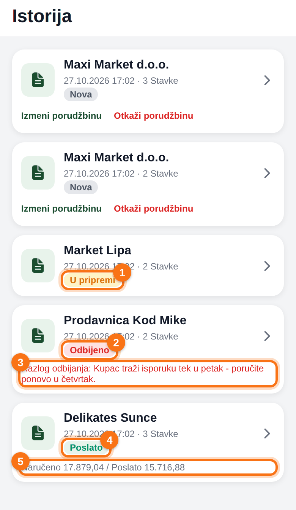

| Status | Značenje | Šta vi možete |
|---|---|---|
| **Nova** | Poslata, magacin je još nije preuzeo. | Izmena i otkazivanje. |
| **U pripremi** (1) | Magacin je preuzeo i pakuje. | Samo pregled. Za izmenu se javite magacinu ili administratoru. |
| **Odbijeno** (2) | Magacin je odbio porudžbinu. Ispod piše **razlog** (3). | Po potrebi napravite novu porudžbinu. |
| **Poslato** (4) | Roba je poslata kupcu. | Samo pregled. Ako je poslato manje nego naručeno, vidi se **Naručeno … / Poslato …** (5). |
| **Otkazano** | Vi ste je otkazali. | Samo pregled. |

> Kad magacin porudžbinu pošalje ili odbije, na email dobijate obaveštenje.

### Izmena porudžbine
**Izmeni porudžbinu** otvara katalog sa već unetim kupcem, količinama i popustima.

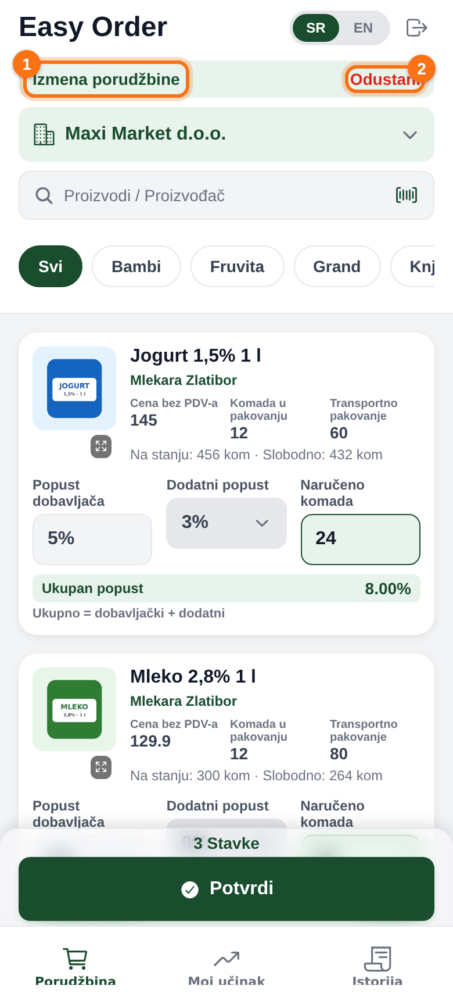

1. Traka **Izmena porudžbine** – menjate postojeću porudžbinu, ne pravite novu.
2. **Odustani** – izlazak bez izmena.

Promenite šta treba i pritisnite **Potvrdi**. Ako je magacin u međuvremenu preuzeo porudžbinu, izmena više nije moguća i aplikacija će to javiti.

---

## 9. Moj učinak – cilj i napredak

Ako vaša firma prati ciljeve prodaje, administrator vam postavlja cilj za tekući mesec, a vi na kartici **Moj učinak** (dole u sredini) vidite koliko ste do sada ostvarili. Vidite samo svoje rezultate, ne i rezultate kolega.

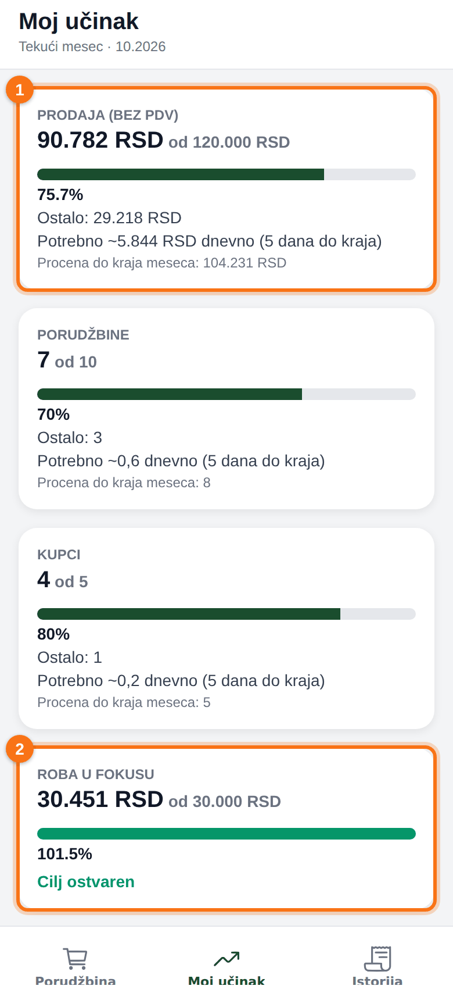

1. **Prodaja (bez PDV)** – vaša prodaja u tekućem mesecu od ukupnog cilja. Ispod su:
   - traka sa **procentom** ostvarenja,
   - **Ostalo** – koliko još fali do cilja,
   - **Potrebno … dnevno** – koliko dnevno treba da ostvarite do kraja meseca (uz broj dana koji je ostao),
   - **Procena do kraja meseca** – gde ćete biti ako nastavite istim tempom.
2. **Roba u fokusu** – koliko ste prodali artikala koje je administrator označio kao fokus. Kad je cilj dostignut, traka postaje zelena i piše **Cilj ostvaren**.

Ispod su još kartice za **Porudžbine** (broj porudžbina) i **Kupci** (broj različitih kupaca kojima ste prodali), ako je za njih postavljen cilj.

### Šta se računa
- Računa se svaka porudžbina koju ste napravili u tekućem mesecu, čim je potvrdite. Ne čeka se da magacin pošalje robu.
- **Otkazane i odbijene** porudžbine se ne računaju.
- Kad magacin pošalje manje nego što je naručeno, računa se stvarno poslata količina.
- Iznosi su **bez PDV-a**, sa uračunatim popustima.
- Svakog prvog u mesecu brojači kreću od nule. Cilj za novi mesec postavlja administrator.

### Prethodni meseci
Na dnu ekrana su poslednja tri meseca, da vidite kako ste prošli.

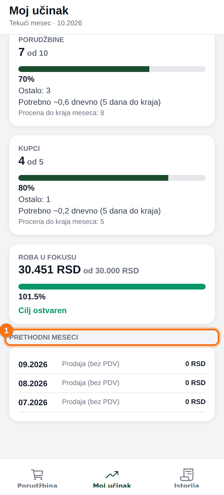

1. **Prethodni meseci** – za svaki mesec ostvarenje i cilj (ako je bio postavljen) sa procentom.

> Ekran osvežavate povlačenjem nadole. Ako piše da cilj još nije postavljen, javite se administratoru, a do tada vidite samo ono što ste ostvarili.

---

## 10. Skeniranje barkoda

Dodirnite ikonicu barkoda u polju za pretragu (odeljak 2, broj 3).

1. Prvi put telefon traži dozvolu za kameru – dozvolite je.
2. Barkod artikla postavite u okvir na ekranu.
3. Kad aplikacija prepozna kod, kamera se zatvara i prikazuje se taj artikal.

Ako se ne prikaže nijedan artikal (**Nema proizvoda**), taj barkod još nije upisan ni kod jednog artikla. Pronađite artikal po nazivu i javite administratoru barkod.

---

## 11. Obaveštenja u aplikaciji

- **Nova verzija aplikacije** – pri pokretanju se može pojaviti poruka **Dostupna je nova verzija**. Izaberite **Preuzmi sada** i instalirajte (podaci ostaju).
- **Izmene su spremne** – manja izmena je preuzeta sama; izaberite restart ili sačekajte sledeće pokretanje.
- **Traka na vrhu ekrana** – važna obaveštenja vaše firme ili sistema (npr. o pretplati). Za pitanja se obratite administratoru.

---

## 12. Česta pitanja i problemi

**„Server nije dostupan. Proverite internet vezu.“**
Telefon nema internet. Uključite mobilne podatke ili Wi-Fi i pokušajte ponovo. Unete količine ostaju dok ne zatvorite aplikaciju.

**„Previše neuspešnih pokušaja. Pokušajte ponovo za 15 minuta.“**
Pet puta je uneta pogrešna lozinka. Sačekajte 15 minuta ili koristite **Zaboravljena lozinka?**.

**„Nalog ili firma su deaktivirani“ / „Pretplata je istekla“**
Obratite se administratoru vaše firme.

**Šta znači narandžasti okvir i oznaka „U fokusu“ na artiklu?**
Administrator želi da taj artikal ponudite kupcu (višak, bliži rok ili akcija). Vidi odeljak 5.

**Ne vidim karticu „Moj učinak“.**
Vaša firma ne koristi praćenje ciljeva. Pitajte administratora.

**Ne vidim neki artikal.**
Artikal je neaktivan ili ne postoji u katalogu. Javite administratoru.

**Pogrešio sam u porudžbini.**
Dok je **Nova** – **Istorija** → **Izmeni porudžbinu** ili **Otkaži porudžbinu**. Kad je **U pripremi**, javite magacinu.

**Kupac traži narudžbenicu kasnije.**
**Istorija** → dodirnite porudžbinu → **Pošalji na email** ili **Sačuvaj PDF**.
