# Uputstvo za magacin

Komercijalisti u Easy Order aplikaciji prave porudžbine, a one stižu u magacin. Magacioner ih preuzima, pakuje, šalje (ili odbija), a uz to evidentira **prijem robe**, radi **popis** i prati **rokove trajanja**. Sve se radi na telefonu u Android aplikaciji, a isto može i na računaru u portalu (odeljak 9).

> **Ukratko – šta radite svaki dan**
>
> **Porudžbina:** **Početna** → **Porudžbine** → otvorite porudžbinu → **Preuzmi** → čekirajte stavke (i po potrebi smanjite količinu) → **Pošalji**.
>
> **Prijem robe:** **Magacin** → **Prijem** → skenirajte artikal (ili ga potražite po nazivu) → količina (i rok, ako artikal ima rok) → **Potvrdi prijem**.
>
> **Popis:** **Magacin** → **Popis** → skenirajte artikal → upišite izbrojano → napomena → **Potvrdi popis**.
>
> **Rokovi:** **Magacin** → **Rokovi** → proverite šta ističe i otpišite ono što je isteklo.

Na slikama su važni delovi uokvireni narandžastim okvirom, a broj u krugu odgovara broju u tekstu ispod slike.

> **Šta vidite zavisi od paketa vaše firme.** Pakovanje porudžbina je uvek tu. Kartice **Prijem** i **Popis** postoje samo ako firma koristi zalihe, a **Rokovi** samo ako koristi praćenje roka trajanja. Ako neku karticu ne vidite, obratite se administratoru.

---

## 1. Prva prijava

Kada vam administrator otvori nalog, na email stiže poruka sa linkom za preuzimanje Android aplikacije, vašim emailom i **privremenom lozinkom**. Instalirajte aplikaciju (ako telefon pita za dozvolu instalacije iz ovog izvora, potvrdite) i prijavite se.

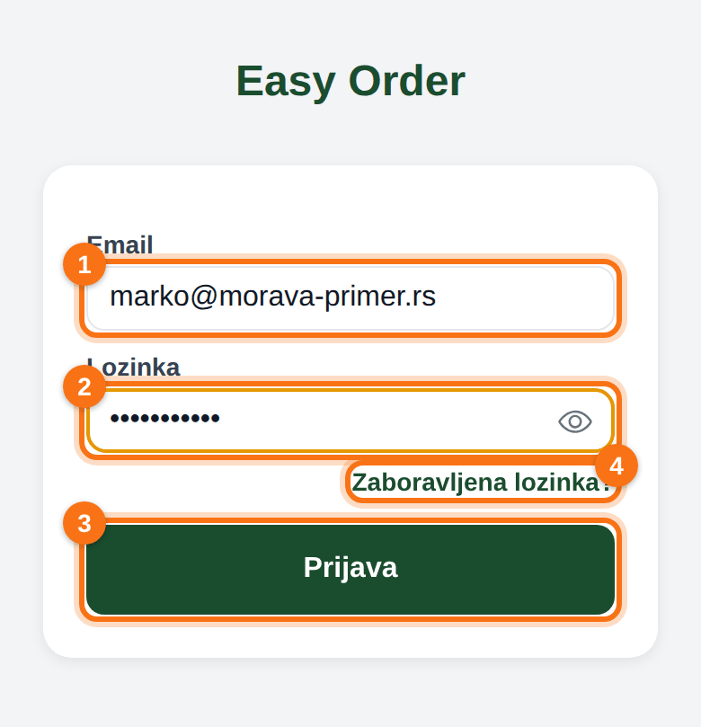

1. **Email** – email na koji ste dobili poruku.
2. **Lozinka** – privremena lozinka iz emaila (ikonica oka prikazuje šta ste ukucali).
3. **Prijava**.
4. **Zaboravljena lozinka?** – unesite email i stiže link za novu lozinku.

Pri prvoj prijavi aplikacija traži da privremenu lozinku zamenite svojom.

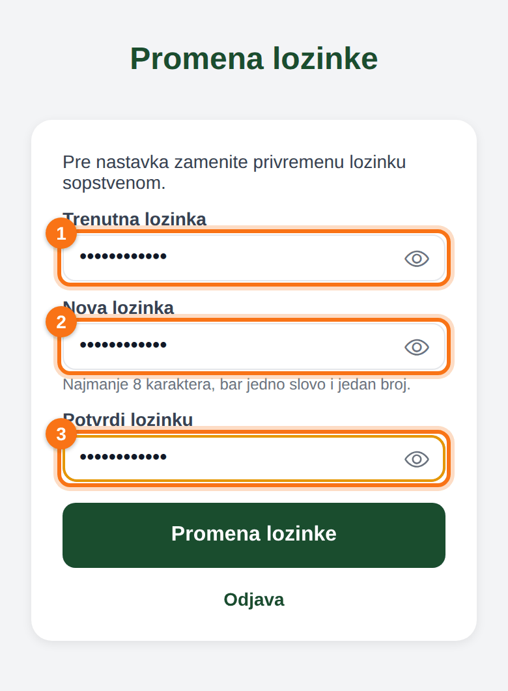

1. **Trenutna lozinka** – privremena lozinka iz emaila.
2. **Nova lozinka** – najmanje 8 znakova, bar jedno slovo i jedan broj.
3. **Potvrdi lozinku** – ista lozinka još jednom.

> **Savet:** aplikacija pamti prijavu. Prijavljujete se ponovo samo posle odjave ili promene lozinke.

---

## 2. Početna

Posle prijave otvara se **Početna** sa najvažnijim brojevima.

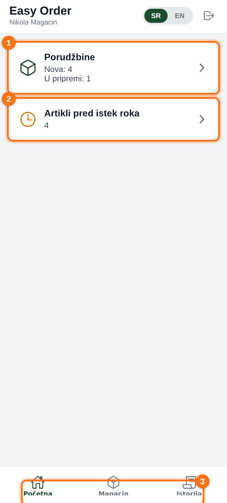

1. **Porudžbine** – koliko je porudžbina **Nova** (niko ih još nije preuzeo) i koliko je **U pripremi**. Dodir otvara spisak za pakovanje.
2. **Artikli pred istek roka** – koliko je serija kojima rok ističe ili je istekao. Dodir otvara karticu **Rokovi**. (Vidi se samo ako firma prati rokove.)
3. **Donja traka** – tri kartice: **Početna**, **Magacin** (sav rad) i **Istorija** (sve porudžbine firme).

U gornjem desnom uglu su izbor jezika (**SR / EN**) i odjava. Povlačenjem nadole osvežavate brojeve.

---

## 3. Kartica Magacin

Kartica **Magacin** ima prekidač sa karticama za različite poslove.

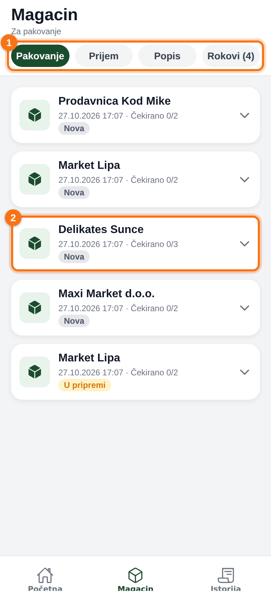

1. **Prekidač**: **Pakovanje** (porudžbine), **Prijem** (nova roba), **Popis** (brojanje) i **Rokovi**. Broj u zagradi kod **Rokovi** je koliko serija zahteva pažnju.
2. **Porudžbina na čekanju** – ime kupca, datum, **Čekirano 0/3** (koliko ste stavki već čekirali) i status. Najnovije su na vrhu, a one koje ste već preuzeli (**U pripremi**) su uz ostale na istom spisku.

Dodirom na porudžbinu otvarate njene stavke. Povlačenjem nadole osvežavate spisak. Poslate i odbijene porudžbine nestaju sa spiska, nalaze se u **Istoriji**.

---

## 4. Pakovanje i slanje porudžbine

### Korak 1 – otvorite porudžbinu i preuzmite je
Primer: kupac Delikates Sunce naručio je 36 sokova od jabuke, 24 jogurta i 3 kg sira gaude.

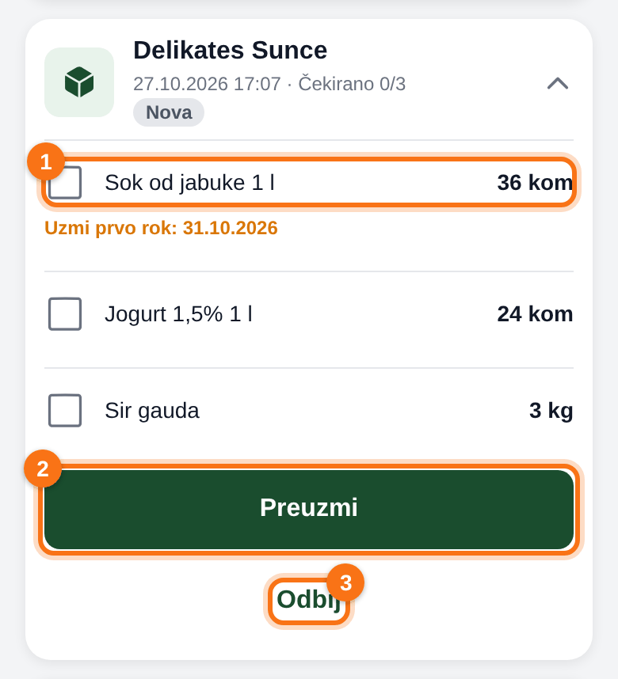

1. **Stavka** sa naručenom količinom (36 kom, 24 kom, 3 kg). Kvadratić levo je za čekiranje.
2. **Preuzmi** – kažete da vi pakujete ovu porudžbinu. Status prelazi u **U pripremi**, a komercijalista više ne može da je menja.
3. **Odbij** – ako porudžbinu ne možete da ispunite (odeljak niže).

Narandžasti red **Uzmi prvo rok: 31.10.2026** vidi se kod artikala sa rokom trajanja: uzmite sa police robu sa tim (najranijim) rokom. Program sam skida sa stanja seriju sa najranijim rokom.

### Korak 2 – spakujte i čekirajte
Za svaku stavku uzmite robu sa police i čekirajte je. Dodir na kvadratić postavlja da je spakovano **koliko je naručeno**. Ponovni dodir skida čekiranje.

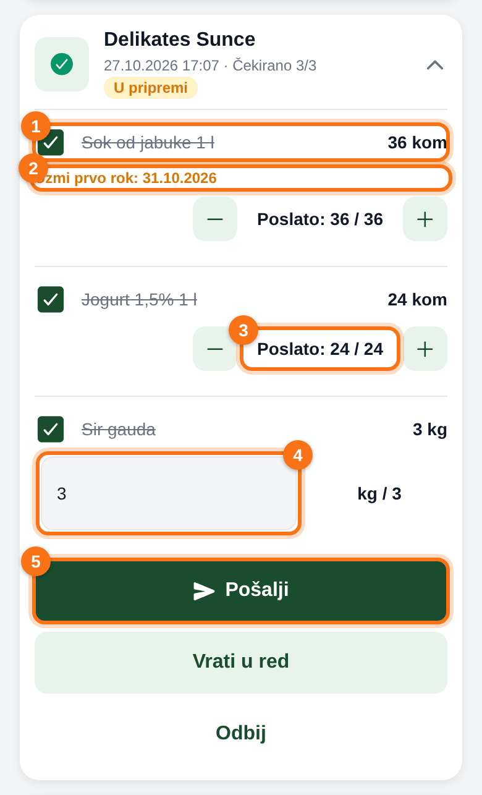

1. **Čekirana stavka** – precrtana je i označena kao spakovana.
2. **Uzmi prvo rok** – datum najranijeg roka za taj artikal.
3. **Poslato: 24 / 24** – koliko ste spakovali od naručenog. Dugmići **−** i **+** menjaju količinu, a ne možete da pošaljete više nego što je naručeno.
4. **Artikli na kilograme, litre i metre** – umesto dugmića je polje u kome upisujete količinu u toj jedinici (npr. 2,5 za 2,5 kg).
5. **Pošalji** – postaje aktivno tek kad su sve stavke čekirane.

> Dok sve stavke nisu čekirane, piše: **Čekiraj sve stavke da bi poslao porudžbinu.**

### Ako nemate celu naručenu količinu
Smanjite količinu dugmetom **−** (ili upišite manju količinu kod kg). Komercijalista i faktura prikazuju ono što ste stvarno poslali.

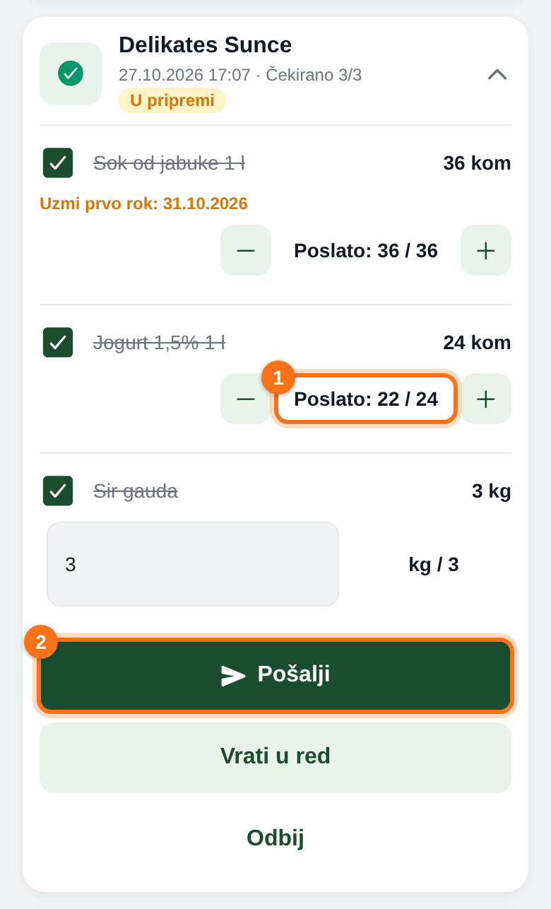

1. **Poslato: 22 / 24** – kupac dobija 22 jogurta, a ne 24.
2. **Pošalji** – šalje porudžbinu sa spakovanim količinama.

Bar jedna stavka mora imati količinu veću od nule. Ako ne možete da pošaljete ništa, odbijte porudžbinu.

### Korak 3 – pošaljite
Pritisnite **Pošalji**. Šta se dešava:

- porudžbina dobija status **Poslato** i nestaje sa spiska,
- broj fakture se dodeljuje automatski (osim ako firma ručno vodi brojeve, vidi dole),
- komercijalista dobija email da je porudžbina poslata,
- ako firma vodi zalihe, poslata količina se skida sa stanja.

> **Ručni broj fakture:** ako firma ručno vodi brojeve faktura, ispred dugmeta **Pošalji** pojavljuje se polje **Broj fakture**. Upišite broj sa vaše fakture. Bez njega slanje nije moguće, a isti broj ne može da se upotrebi dvaput.

### Ostale radnje na porudžbini
- **Vrati u red** – vraća porudžbinu u status **Nova** (npr. ako ste je preuzeli greškom). Dostupno dok porudžbina nije poslata.
- **Odbij** – odbijanje porudžbine, vidi dole.

### Odbijanje porudžbine
Dodirnite **Odbij**, upišite **razlog** i pritisnite **Odbij**.

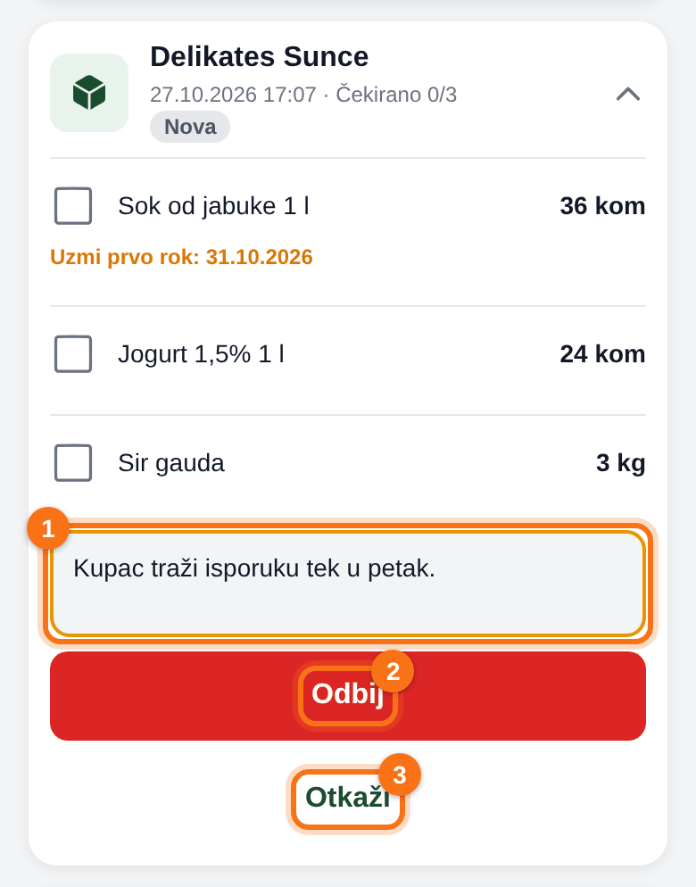

1. **Razlog odbijanja** – obavezan. Komercijalista ga vidi na porudžbini i dobija ga emailom.
2. **Odbij** – odbija porudžbinu.
3. **Otkaži** – odustajete, porudžbina ostaje kakva je bila.

> **Poslatu porudžbinu ne možete da vratite ni da izmenite.** Ako ste poslali pogrešno, javite se administratoru firme, a ispravku radi Easy Order podrška.

---

## 5. Prijem robe

Kad stigne roba od dobavljača, upišite je na stanje: **Magacin** → **Prijem**.

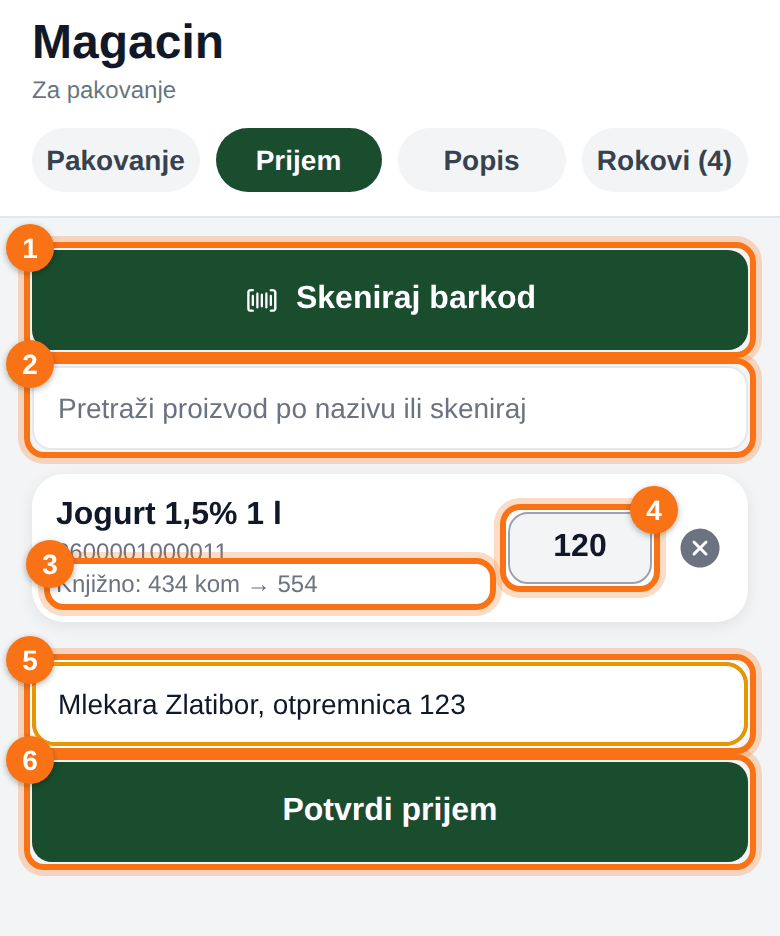

1. **Skeniraj barkod** – otvara kameru (objašnjeno niže).
2. **Pretraga** – kucajte deo naziva artikla i dodirnite ga u spisku koji se pojavi. Svaki dodir dodaje jedan komad.
3. **Knjižno: 434 kom → 554** – trenutno stanje u sistemu i stanje posle ovog prijema.
4. **Količina** – upišite koliko je stiglo (ovde 120). Strelica **×** uklanja stavku sa spiska.
5. **Napomena** – nije obavezna, korisno je upisati dobavljača ili broj otpremnice.
6. **Potvrdi prijem** – upisuje sve stavke odjednom.

Možete da dodate više artikala pre potvrde. Količine se upisuju tek kad pritisnete **Potvrdi prijem**.

### Skeniranje barkoda
1. Dodirnite **Skeniraj barkod**. Prvi put telefon traži dozvolu za kameru, dozvolite je.
2. Barkod postavite u okvir na ekranu. Kamera ostaje otvorena, a brojač pokazuje šta ste skenirali.
3. Svako skeniranje dodaje **jedan komad**. Ako skenirate barkod **kutije**, odmah se dodaje ceo broj komada iz kutije.
4. Kad završite, zatvorite kameru. Stavke su na spisku, gde ispravljate količine.

> Isti artikal skenirajte ponovo tek kad kameru sklonite sa koda. Brojač tako ne bi brojao jedan komad dvaput.

### Artikal koji sistem ne poznaje
Ako je barkod nepoznat, pojavi se poruka **Nema proizvoda sa ovim barkodom**. Prvo izaberite da li je to barkod **Komada** ili **Kutije**, pa:

- **Dodaj novi artikal** – upišite naziv (obavezno), a po želji proizvođača i pakovanje. Artikal se pravi odmah i ulazi u prijem. Cenu i PDV zatim podešava administrator, do tada se artikal ne vidi komercijalistima.
- **Poveži sa postojećim artiklom** – barkod se upisuje uz artikal koji već postoji. Dobra opcija kad artikal postoji ali mu barkod nije bio upisan.

### Artikli koji imaju rok trajanja
Za artikle sa rokom morate da upišete rok za svaku isporuku.

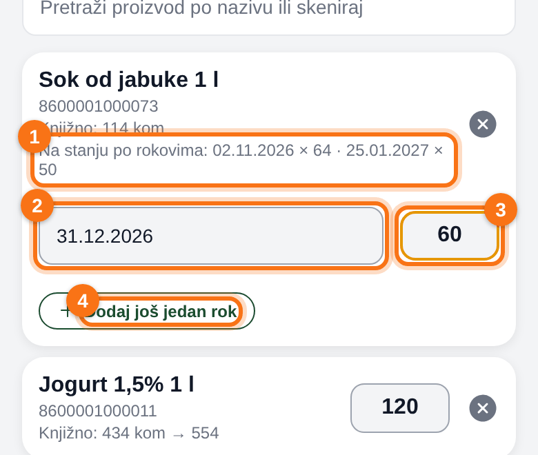

1. **Na stanju po rokovima** – šta je do sada na stanju i sa kojim rokom.
2. **Rok** – upišite samo cifre (npr. 31122026), tačke se dodaju same: 31.12.2026.
3. **Količina** sa tim rokom.
4. **Dodaj još jedan rok** – ako je u istoj isporuci roba sa različitim rokovima, dodajte red za svaki rok.

Ako je datum nepravilan, ispod piše upozorenje i prijem nije moguće potvrditi.

### Artikli na kilograme i litre
Količinu upisujete u jedinici artikla, npr. **25** za 25 kg ili **2,5** za dva i po kilograma.

---

## 6. Popis

Popis služi da stanje u sistemu uskladite sa stvarnim stanjem na polici: **Magacin** → **Popis**.

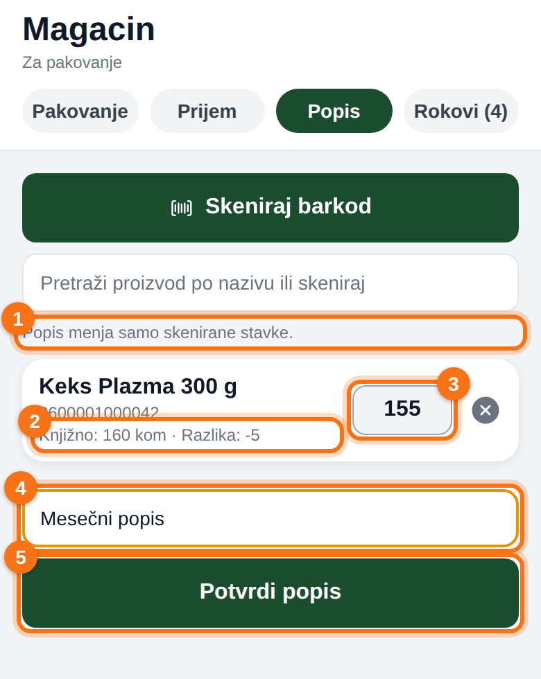

1. **Popis menja samo skenirane stavke.** Artikli koje ne dodate na spisak ostaju kakvi jesu.
2. **Knjižno** je stanje u sistemu, a **Razlika** je koliko se vaše brojanje razlikuje od njega (ovde −5: u sistemu je 160, a izbrojali ste 155).
3. **Količina** – upišite **koliko ste izbrojali**, ne razliku.
4. **Napomena** – za popis je obavezna (npr. „Mesečni popis“).
5. **Potvrdi popis** – stanje se postavlja na izbrojano. Svaka promena ostaje zabeležena sa vašim imenom i napomenom.

Artikle dodajete skeniranjem ili pretragom, kao kod prijema.

> **Artikli sa rokom:** za njih upisujete izbrojano po rokovima. Pored već postojećih rokova ispod kartice su dugmići sa datumima, jedan dodir dodaje red za taj rok. **Pažnja:** rok koji ne navedete na kartici postavlja se na **nulu**.

---

## 7. Rokovi trajanja

Kartica **Rokovi** prikazuje serije kojima rok ističe ili je istekao.

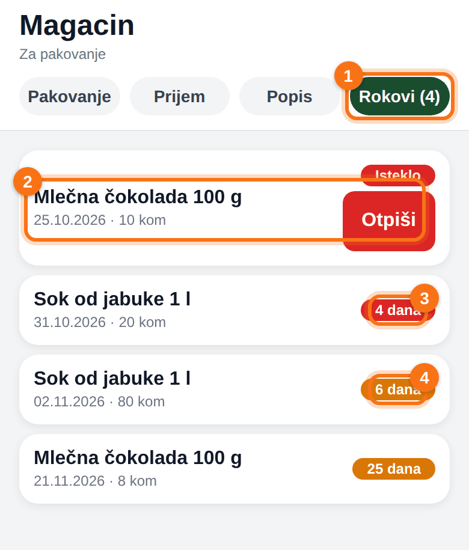

1. **Rokovi (4)** – broj serija kojima treba pažnja.
2. **Isteklo** – serija čiji je rok prošao, sa crvenim dugmetom **Otpiši**. Otpis skida celu seriju sa stanja (aplikacija traži potvrdu).
3. **Crveno (4 dana)** – rok ističe vrlo skoro.
4. **Narandžasto (6 dana, 25 dana)** – rok ističe uskoro, ali ima vremena.

Spisak je poređan po roku, najhitnije je na vrhu. Pragovi upozorenja (podrazumevano 30, 15 i 5 dana) mogu da se menjaju, pitajte administratora.

Pri pakovanju vam se pored artikla sa rokom prikazuje **Uzmi prvo rok** (najraniji rok na stanju) i, ako ima isteklih komada, **Isteklo na stanju**. Istekla roba se nikad ne ubraja u slobodno stanje.

---

## 8. Istorija

Kartica **Istorija** (dole desno) prikazuje sve porudžbine firme, najnovije na vrhu.

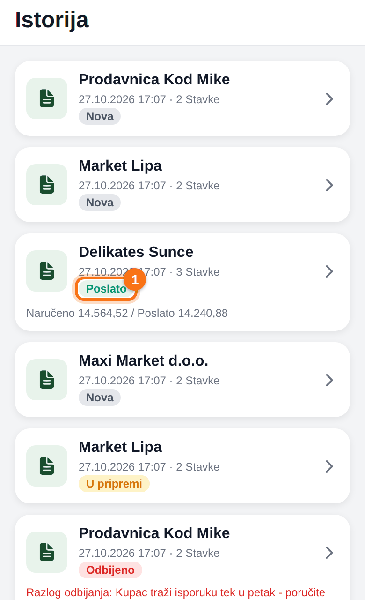

1. **Status** (Nova, U pripremi, Poslato, Odbijeno, Otkazano). Kod poslate porudžbine ispod piše **Naručeno … / Poslato …** (iznosi) ako ste poslali manje nego što je naručeno. Kod odbijene piše razlog.

Dodirom na porudžbinu otvarate fakturu. Možete da je sačuvate kao PDF ili pošaljete emailom.

---

## 9. Rad na računaru (portal)

Sve što radite u aplikaciji može i na računaru, u portalu (link je u emailu koji ste dobili pri otvaranju naloga). Prijavljujete se istim emailom i lozinkom. Portal je za računar, na telefonu koristite aplikaciju.

Meni ima tri stavke: **Magacin** (pakovanje), **Stanje** (zalihe i rokovi) i **Narudžbine** (pregled svih porudžbina, sa fakturom i otpremnicom za štampu).

### Magacin – pakovanje

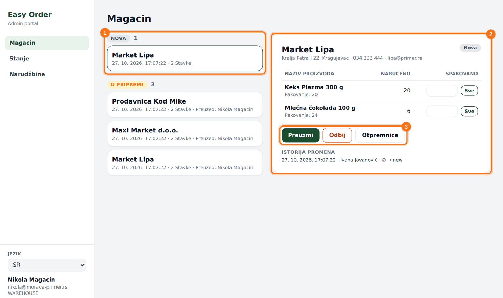

1. **Spisak porudžbina** podeljen na **Nova** i **U pripremi**. Uz porudžbinu koju je neko preuzeo piše ko ju je preuzeo.
2. **Porudžbina** – kupac sa adresom i kontaktom, naručene stavke i polja za spakovanu količinu.
3. **Dugmići**: **Preuzmi**, **Odbij** i **Otpremnica**.

Kad preuzmete porudžbinu, za svaku stavku upišite spakovanu količinu ili pritisnite **Sve** (spakovano je koliko je naručeno).

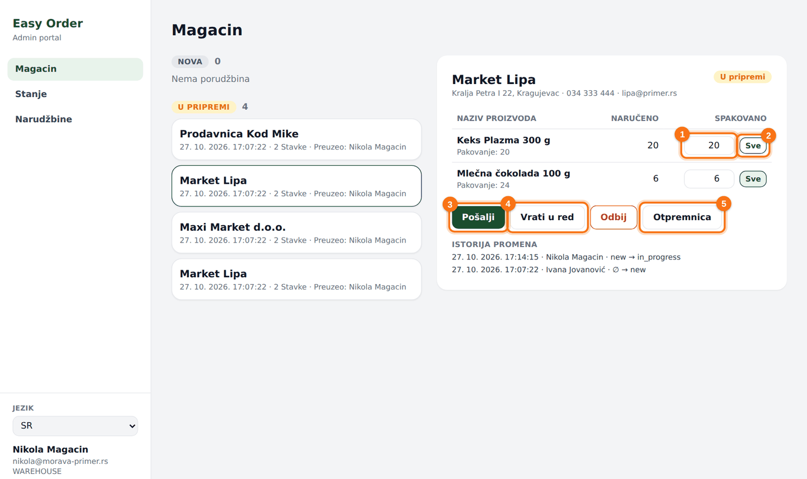

1. **Polje za količinu** – upišite koliko ste spakovali (ne može više od naručenog).
2. **Sve** – popunjava naručenu količinu.
3. **Pošalji** – šalje porudžbinu. Aktivno je kad su sve stavke popunjene.
4. **Vrati u red** – porudžbina se vraća u **Nova**.
5. **Otpremnica** – otvara otpremnicu.

Pod porudžbinom je **Istorija promena**: ko je i kada menjao status.

### Otpremnica
**Otpremnica** je dokument koji ide uz robu. Sadrži podatke o firmi i kupcu i spisak spakovanih količina.

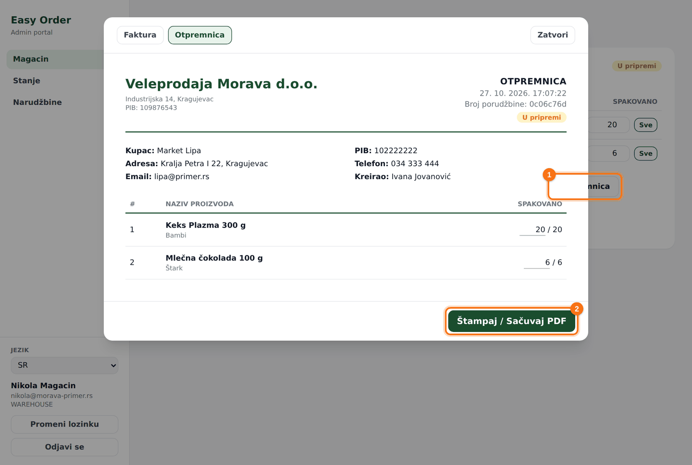

1. **Faktura / Otpremnica** – prebacivanje između dva dokumenta.
2. **Štampaj / Sačuvaj PDF** – štampa ili čuva PDF.

### Stanje

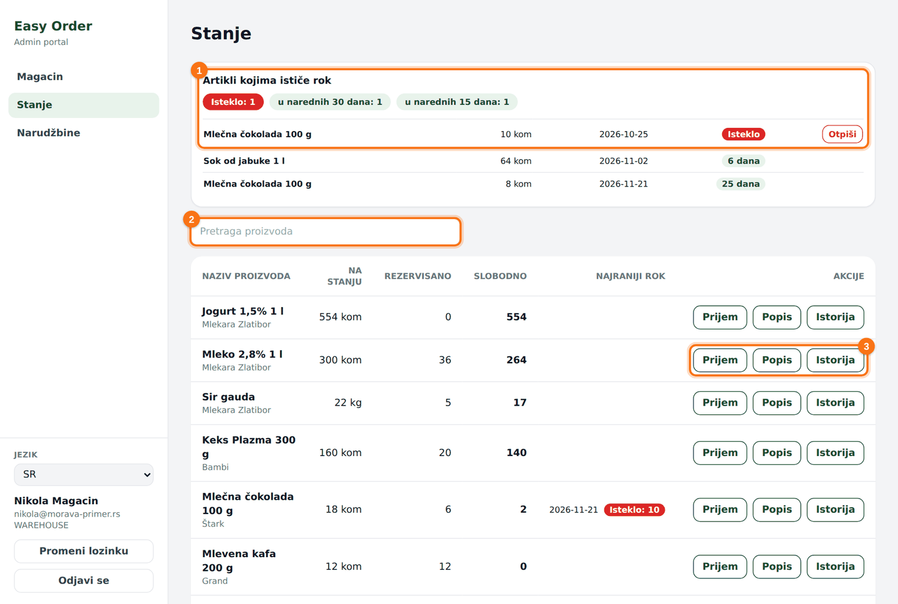

1. **Artikli kojima ističe rok** – isto što i kartica **Rokovi** u aplikaciji, sa dugmetom **Otpiši** za istekle serije.
2. **Pretraga proizvoda**.
3. **Prijem**, **Popis** i **Istorija** za svaki artikal: upis prijema, popis ili pregled svih promena stanja (ko je i kada menjao).

U tabeli su **Na stanju** (u sistemu), **Rezervisano** (porudžbine koje čekaju slanje), **Slobodno** (na stanju minus rezervisano) i **Najraniji rok**.

---

## 10. Obaveštenja u aplikaciji

- **Nova verzija aplikacije** – pri pokretanju se može pojaviti poruka **Dostupna je nova verzija**. Izaberite **Preuzmi sada** i instalirajte (podaci ostaju).
- **Izmene su spremne** – manja izmena je preuzeta sama, izaberite restart ili sačekajte sledeće pokretanje.
- **Traka na vrhu ekrana** – važna obaveštenja vaše firme ili sistema.

---

## 11. Česta pitanja i problemi

**Porudžbina je nestala sa spiska.**
Poslate i odbijene porudžbine se ne prikazuju u pakovanju. Nađite je u **Istoriji**.

**Ne mogu da pritisnem Pošalji.**
Čekirajte sve stavke (i bar na jednoj ostavite količinu veću od nule). Ako firma ručno vodi brojeve faktura, upišite i **Broj fakture**.

**Greškom sam preuzeo porudžbinu.**
Pritisnite **Vrati u red**.

**Poslao sam pogrešnu količinu.**
Poslata porudžbina se ne menja. Javite se administratoru firme koji će zatražiti ispravku od Easy Order podrške.

**Barkod se ne skenira.**
Dodajte svetla, držite telefon mirno i približite ga. Ako ne ide, artikal potražite po nazivu u pretrazi.

**Artikal nema barkod ili je barkod nepoznat.**
Izaberite **Dodaj novi artikal** ili **Poveži sa postojećim artiklom** (odeljak 5).

**Stanje artikla je negativno.**
Poslata je veća količina nego što je bilo upisano na stanju. Uradite prijem (ako je roba stigla, a nije upisana) ili popis.

**Ne vidim karticu Prijem, Popis ili Rokovi.**
Vaša firma ih ne koristi (nisu u paketu). Pitajte administratora.

**„Server nije dostupan. Proverite internet vezu.“**
Telefon nema internet. Uključite mobilne podatke ili Wi-Fi i pokušajte ponovo.

**„Previše neuspešnih pokušaja. Pokušajte ponovo za 15 minuta.“**
Pet puta je uneta pogrešna lozinka. Sačekajte 15 minuta ili koristite **Zaboravljena lozinka?**.

**„Nalog ili firma su deaktivirani“ / „Pretplata je istekla“**
Obratite se administratoru vaše firme.
